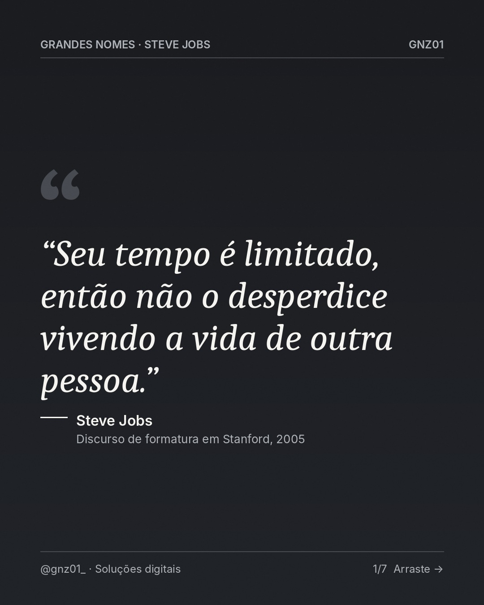
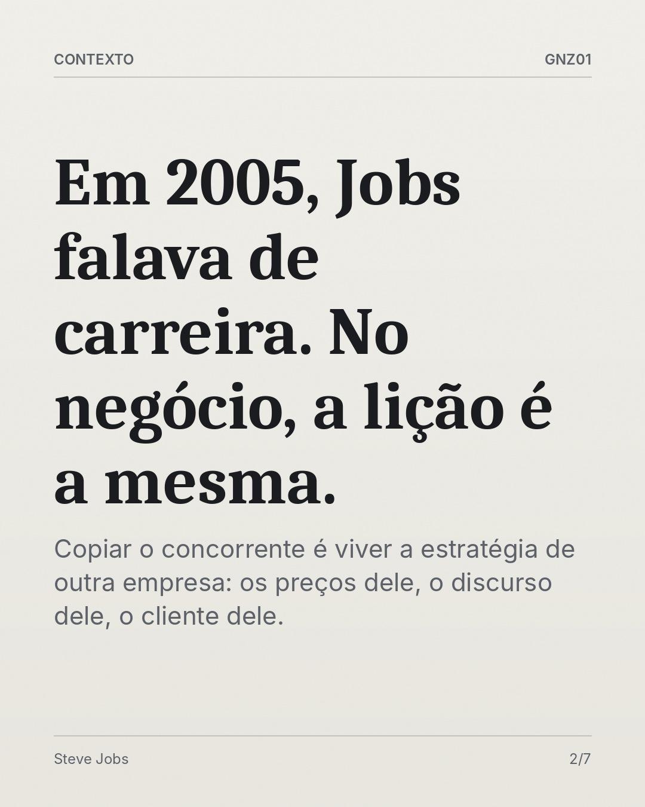

# Seu tempo é limitado, então não o desperdice vivendo a vida de outra pessoa.

- **Data e hora:** 06/11 (sexta), 12:00
- **Formato:** Carrossel (7 slides)
- **Serviço:** Gnz01
- **Pilar:** Autoridade
- **Nicho:** Empreendedores e donos de pequenos negócios
- **Público-alvo:** Empreendedores que copiam o concorrente em vez de se posicionar
- **Objetivo:** Gerar autoridade e salvamentos ligando um ensinamento verificado a posicionamento digital.
- **Técnica de copy:** Citação verificada + contexto + aplicação prática
- **Palavras-chave (SEO):** posicionamento de marca, empreendedorismo, Steve Jobs Stanford
- **CTA:** Comente e salve
- **Status:** agendado

- **Citação original:** Your time is limited, so don't waste it living someone else's life.
- **Fonte verificada:** Discurso de formatura de Steve Jobs na Universidade de Stanford, 12/06/2005 (transcrição oficial publicada pela Stanford News). https://news.stanford.edu/stories/2005/06/youve-got-find-love-jobs-says


## Texto da arte

1. **Capa:** “Seu tempo é limitado, então não o desperdice vivendo a vida de outra pessoa.” / Steve Jobs, Discurso de formatura em Stanford, 2005
2. **Em 2005, Jobs falava de carreira. No negócio, a lição é a mesma.**: Copiar o concorrente é viver a estratégia de outra empresa: os preços dele, o discurso dele, o cliente dele.
3. **Defina o que só você entrega.**: Antes de investir em anúncio ou em um site novo, escreva em uma frase por que o cliente deveria escolher você.
4. **Duas pizzarias na mesma rua.**: Uma copia o cardápio da outra. A segunda mostra a massa de longa fermentação, o forno e o prazo real de entrega. Quem escolhe sabe por que escolheu.
5. **Posicionamento também aparece no digital.**: Site, cardápio e agenda online contam a sua história ou repetem a de todo mundo. O cliente percebe a diferença em segundos.
6. **O que só a sua empresa faz?**: Conte nos comentários. A resposta costuma ser o começo de um bom posicionamento.
7. **Vamos mostrar o que só você entrega?**: Salve este post, compartilhe com um empreendedor e fale com a GNZ01 no WhatsApp {whatsapp}.

## Direção de arte

Carrossel editorial de 7 lâminas. Capa grafite com a citação em serifada itálica, autor e fonte. Fotografia real licenciada de Steve Jobs entra na capa quando disponível (campo foto + crédito); sem foto, versão tipográfica. Lâminas alternam papel off-white e grafite.
Layout: editorial, fundo escuro (preto/grafite).

## Legenda completa

```
"Your time is limited, so don't waste it living someone else's life."
"Seu tempo é limitado, então não o desperdice vivendo a vida de outra pessoa."
Steve Jobs, discurso de formatura em Stanford (2005).

Jobs falava de carreira, mas a lição serve para qualquer negócio: quem copia o concorrente vive a estratégia de outra empresa.

Arraste para ver como transformar isso em posicionamento, do contexto até a aplicação prática no seu negócio. 👉

💬 Conte nos comentários: o que só a sua empresa faz?
💾 Salve para reler quando for planejar sua marca.

Quer que seu site, cardápio ou agenda contem a SUA história? Fale com a GNZ01: (19) 97829-9585

Fonte da citação: transcrição oficial do discurso, Stanford News (news.stanford.edu).
.
.
#empreendedorismo #stevejobs #posicionamentodemarca #gestaodenegocios #gnz01 #solucoesdigitais #criacaodesites #siteprofissional #sitesparaempresas #marketingdigital
```

## Criativos





