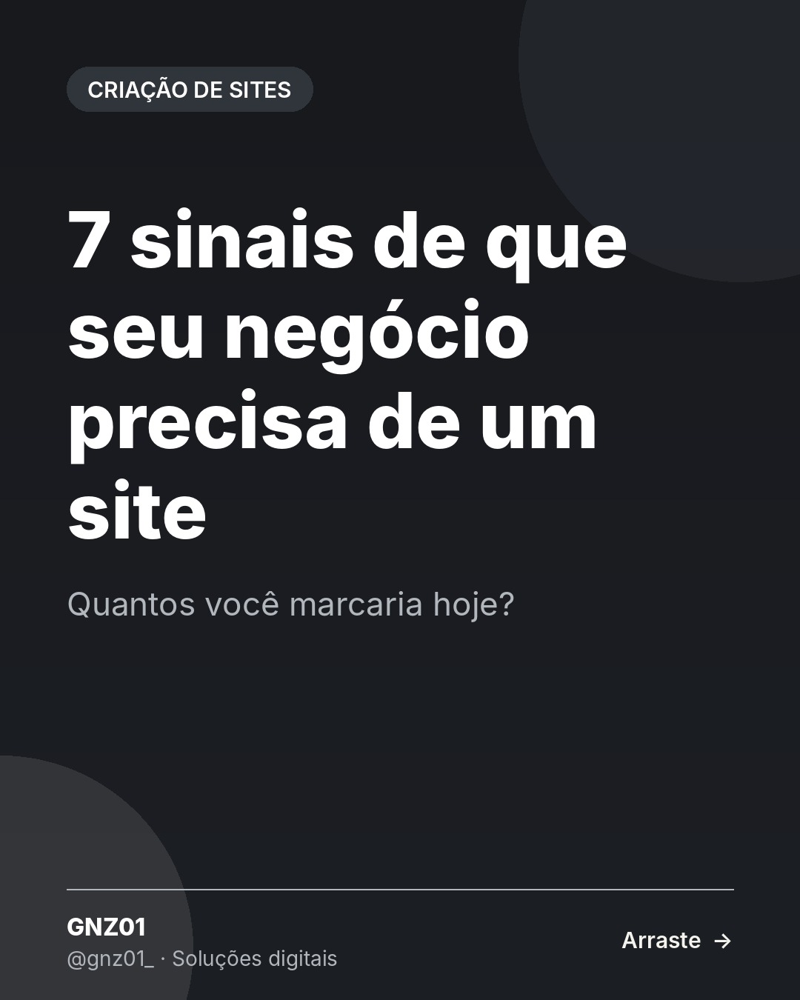
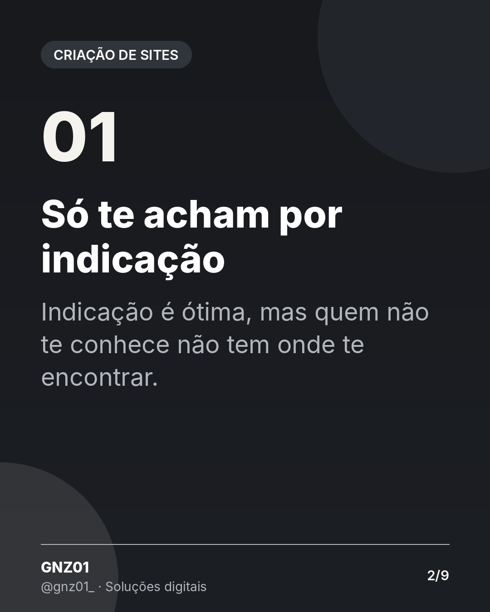
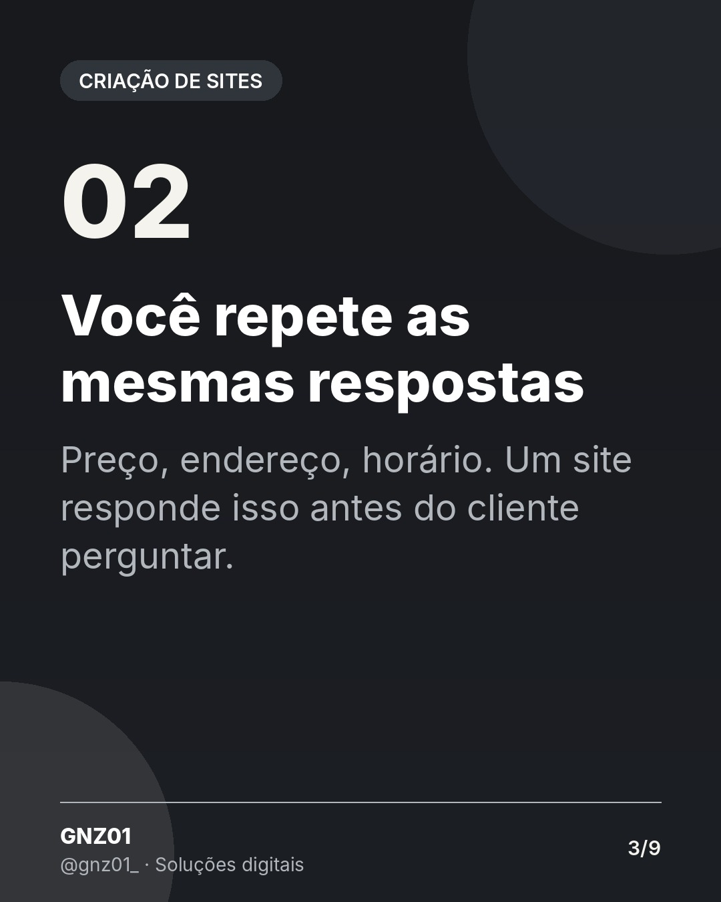
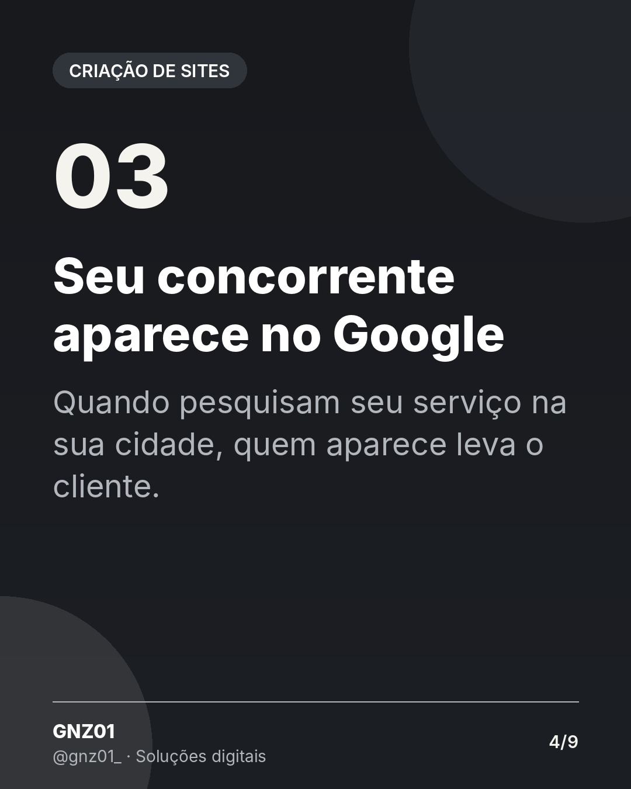
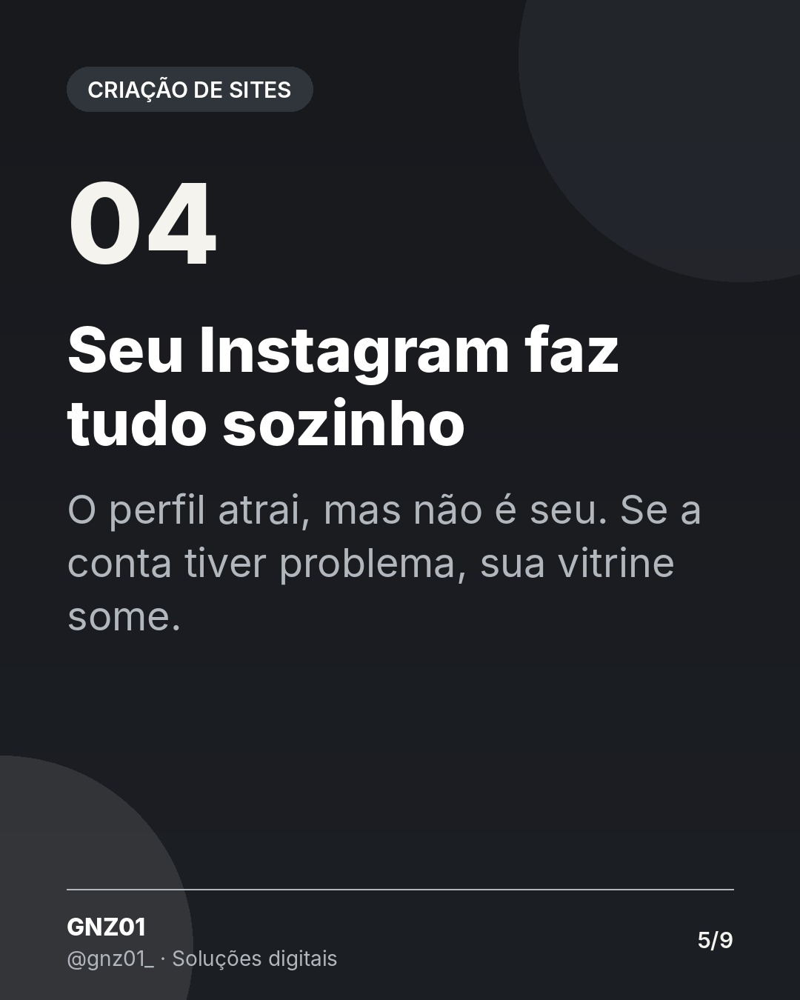
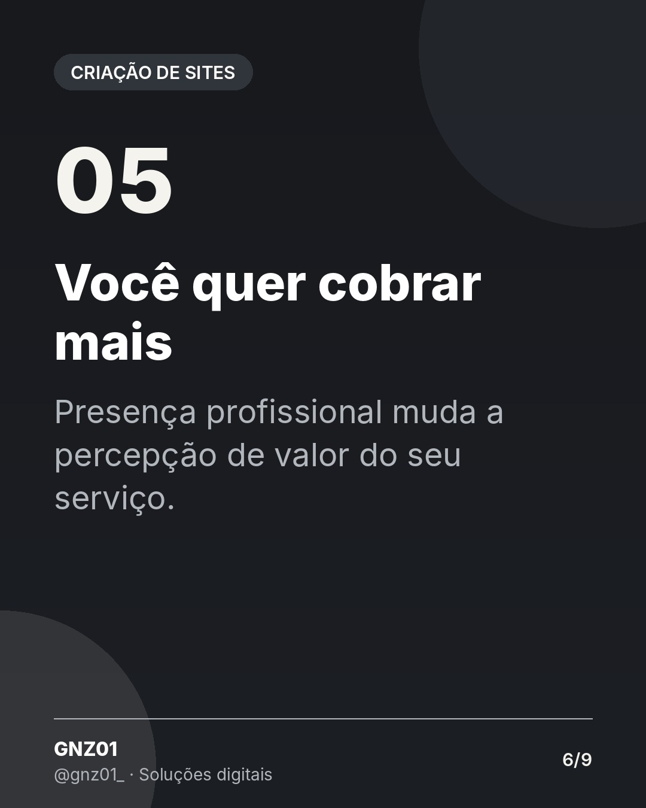
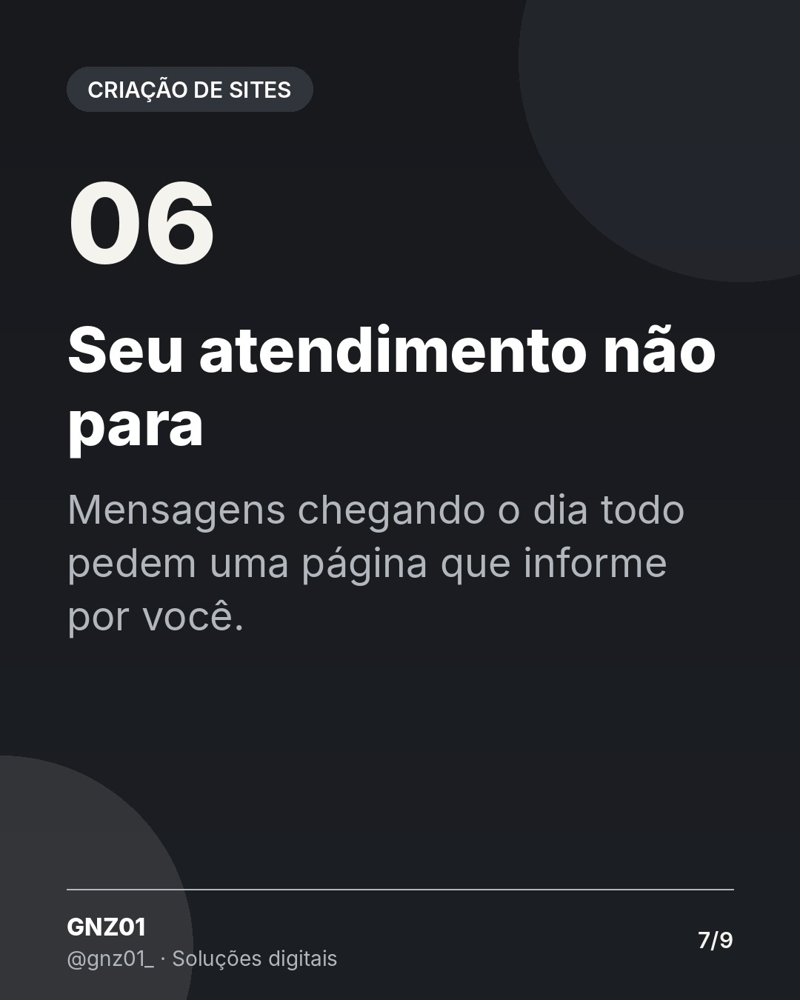
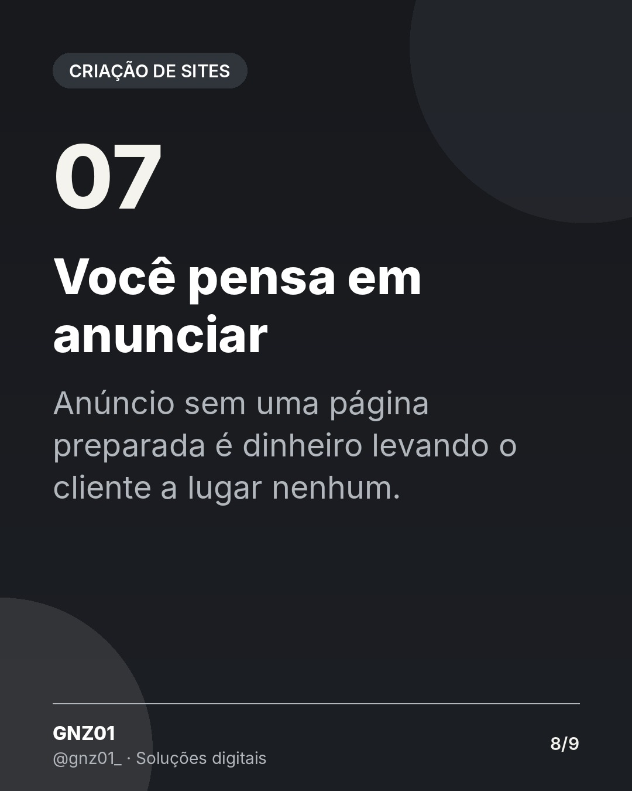

# 7 sinais de que seu negócio precisa de um site

- **Data e hora:** 06/11 (sexta), 12:00
- **Formato:** Carrossel (9 slides)
- **Serviço:** Criação de sites
- **Pilar:** Educação
- **Nicho:** Profissionais autônomos e comerciantes
- **Público-alvo:** Donos de negócio que ainda acham que não precisam de site
- **Objetivo:** Gerar salvamentos e autoridade com um checklist de diagnóstico.
- **Técnica de copy:** Curiosidade + lista de diagnóstico
- **Palavras-chave (SEO):** preciso de um site, site profissional, presença digital
- **CTA:** Envie uma mensagem pelo Direct
- **Status:** agendado


## Texto da arte

1. **Capa:** 7 sinais de que seu negócio precisa de um site / Quantos você marcaria hoje?
2. **Só te acham por indicação**: Indicação é ótima, mas quem não te conhece não tem onde te encontrar.
3. **Você repete as mesmas respostas**: Preço, endereço, horário. Um site responde isso antes do cliente perguntar.
4. **Seu concorrente aparece no Google**: Quando pesquisam seu serviço na sua cidade, quem aparece leva o cliente.
5. **Seu Instagram faz tudo sozinho**: O perfil atrai, mas não é seu. Se a conta tiver problema, sua vitrine some.
6. **Você quer cobrar mais**: Presença profissional muda a percepção de valor do seu serviço.
7. **Seu atendimento não para**: Mensagens chegando o dia todo pedem uma página que informe por você.
8. **Você pensa em anunciar**: Anúncio sem uma página preparada é dinheiro levando o cliente a lugar nenhum.
9. **Final:** Marcou 2 ou mais? Vamos conversar. + botão WhatsApp

## Direção de arte

Capa preta com título forte; slides numerados 01-07 em off-white, texto curto. Último slide com botão off-white do WhatsApp.
Layout: padrão, fundo escuro (preto/grafite).

## Legenda completa

```
Muita gente diz que ainda não precisa de site. Mas os sinais costumam aparecer antes da decisão. 👀

Arrasta para o lado e conte quantos desses você vive hoje.

Se marcou dois ou mais, o seu negócio já está pedindo uma presença digital profissional.

💾 Salve para revisar depois
💬 Me diga no Direct quantos você marcou, ou fale direto no WhatsApp: (19) 97829-9585
.
.
#criacaodesites #siteprofissional #pequenasempresas #profissionalautonomo #sitesparapequenasempresas #facaseusite #siteresponsivo #webdesignerbrasil #orcamentodesite #sitesparaempresas #marketingdigital #empreendedorismo
```

## Criativos










