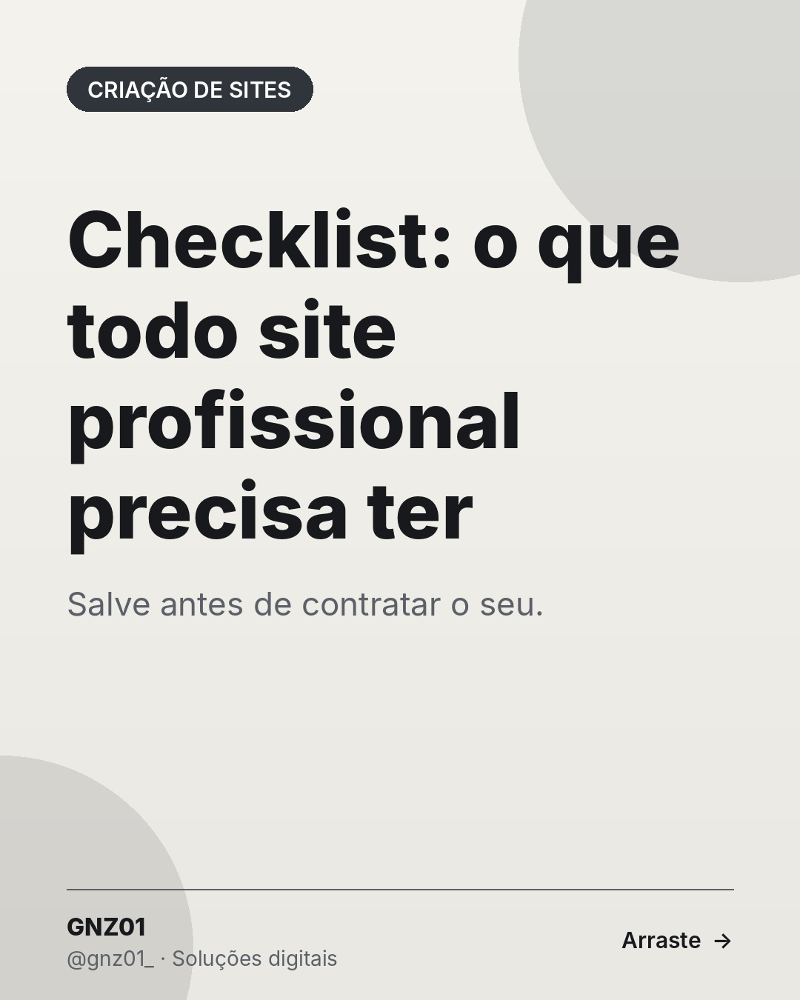
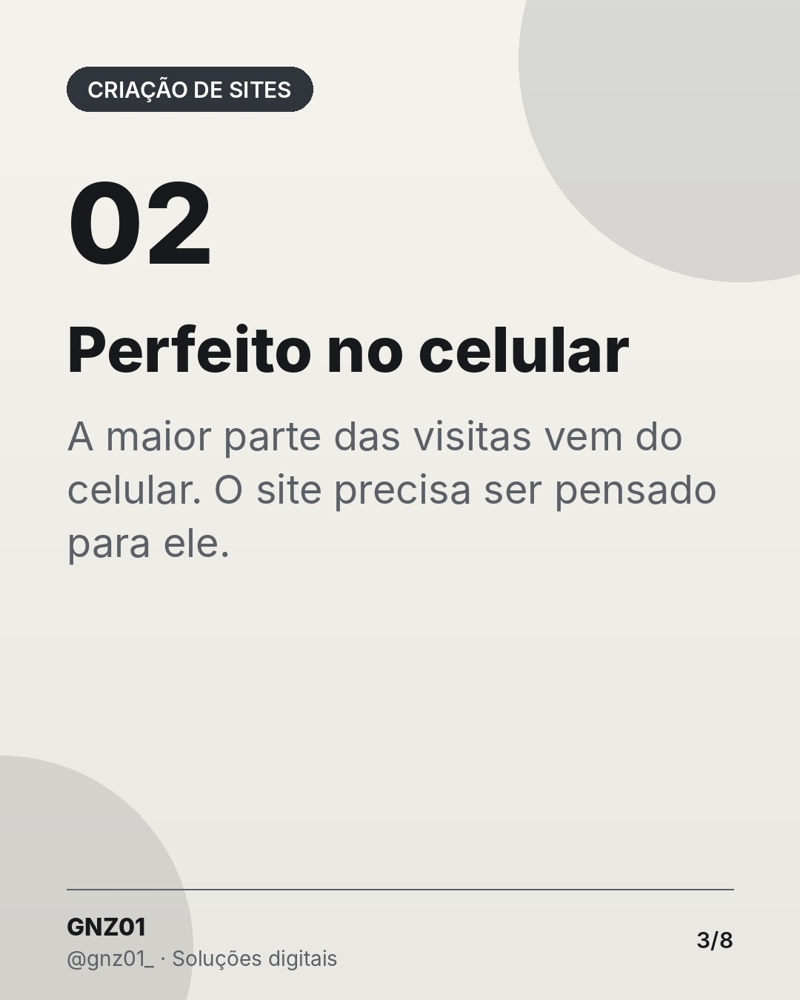
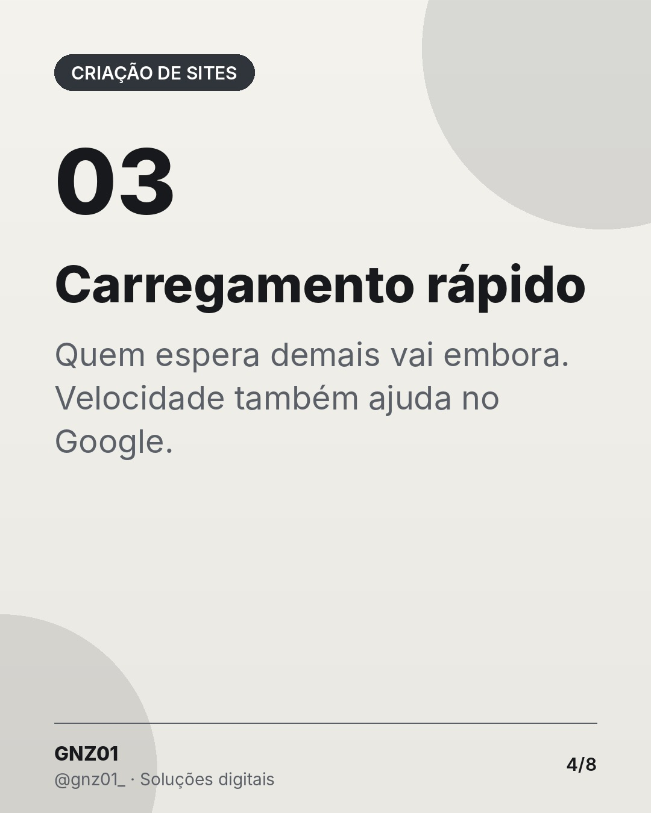
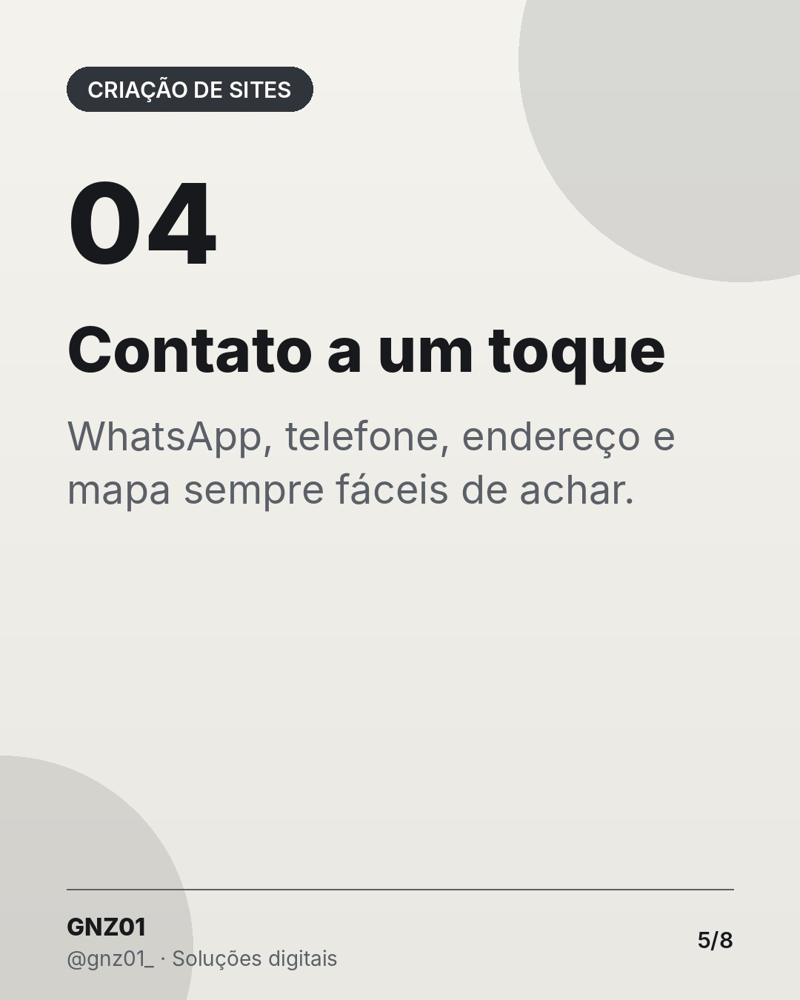

# Checklist: o que todo site profissional precisa ter

- **Data e hora:** 08/11 (domingo), 12:00
- **Formato:** Carrossel (8 slides)
- **Serviço:** Criação de sites
- **Pilar:** Educação
- **Nicho:** Geral
- **Público-alvo:** Quem vai contratar um site
- **Objetivo:** Conteúdo salvável que gera autoridade antes da contratação.
- **Técnica de copy:** Checklist + gatilho de autoridade
- **Palavras-chave (SEO):** checklist site profissional, o que um site precisa ter, contratar site
- **CTA:** Solicite um orçamento personalizado
- **Status:** aguardando aprovação

## Texto da arte

1. **Capa:** Checklist: o que todo site profissional precisa ter / Salve antes de contratar o seu.
2. **Domínio próprio**: seunegocio.com.br passa mais confiança do que um endereço genérico.
3. **Perfeito no celular**: A maior parte das visitas vem do celular. O site precisa ser pensado para ele.
4. **Carregamento rápido**: Quem espera demais vai embora. Velocidade também ajuda no Google.
5. **Contato a um toque**: WhatsApp, telefone, endereço e mapa sempre fáceis de achar.
6. **Prova de trabalho**: Fotos reais, portfólio e avaliações de clientes reais.
7. **Pronto para o Google**: Estrutura e textos pensados para ser encontrado na sua região.
8. **Final:** Quer um site com tudo isso? + botão WhatsApp

## Direção de arte

Carrossel em versão clara (off-white), números pretos, para variar do carrossel escuro de sexta.
Layout: padrão, fundo claro (off-white).

## Legenda completa

```
Antes de contratar um site, confira se ele vai ter o básico que faz diferença. ✅

Arrasta para o lado e salve este checklist.

Na GNZ01, todo site já sai com esses itens. Sem surpresa no final.

💾 Salve para consultar depois
👉 Solicite seu orçamento personalizado: (19) 97829-9585
.
.
#criacaodesites #siteprofissional #webdesign #dicasdemarketing #sitesparapequenasempresas #facaseusite #siteresponsivo #webdesignerbrasil #orcamentodesite #sitesparaempresas #marketingdigital #empreendedorismo
```

## Criativos








