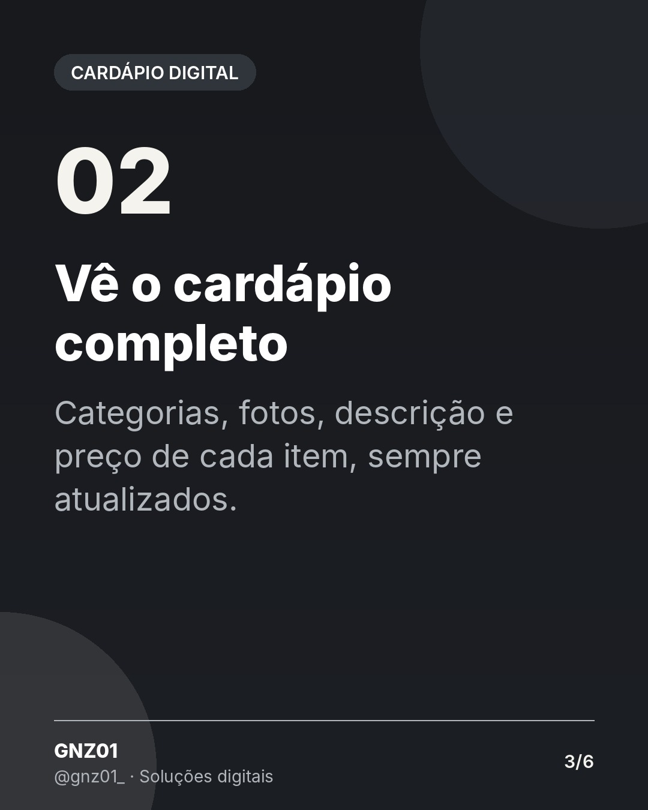
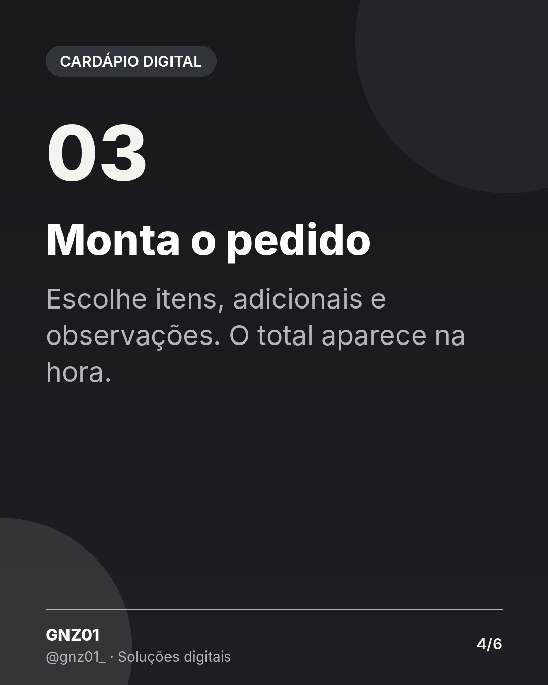
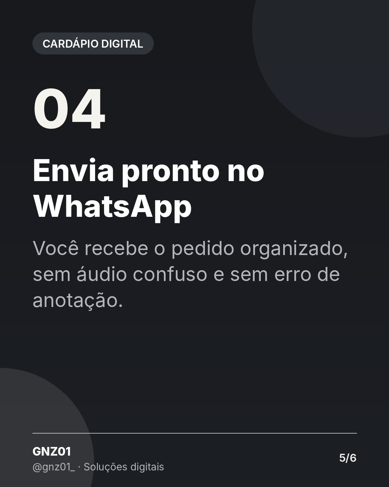

# Do QR Code ao pedido no WhatsApp, em 4 passos

- **Data e hora:** 09/11 (segunda), 12:00
- **Formato:** Carrossel (6 slides)
- **Serviço:** Cardápio digital
- **Pilar:** Demonstração
- **Nicho:** Restaurantes, bares e pizzarias
- **Público-alvo:** Donos de restaurante com atendimento em mesa e delivery
- **Objetivo:** Mostrar o fluxo do QR Code ao pedido e gerar pedidos de demonstração.
- **Técnica de copy:** Passo a passo + demonstração
- **Palavras-chave (SEO):** cardápio QR Code, como funciona cardápio digital, pedido no WhatsApp
- **CTA:** Solicite uma demonstração
- **Status:** aguardando aprovação

## Texto da arte

1. **Capa:** Do QR Code ao pedido no WhatsApp, em 4 passos / Como funciona o cardápio digital na prática.
2. **O cliente aponta a câmera**: QR Code na mesa, no balcão ou na embalagem. Sem baixar aplicativo.
3. **Vê o cardápio completo**: Categorias, fotos, descrição e preço de cada item, sempre atualizados.
4. **Monta o pedido**: Escolhe itens, adicionais e observações. O total aparece na hora.
5. **Envia pronto no WhatsApp**: Você recebe o pedido organizado, sem áudio confuso e sem erro de anotação.
6. **Final:** Quer ver o seu cardápio assim? + botão WhatsApp

## Direção de arte

Carrossel escuro, um passo por slide, números grandes. Último slide com botão off-white.
Layout: padrão, fundo escuro (preto/grafite).

## Legenda completa

```
Como funciona um cardápio digital na prática? Arrasta para o lado. 👉

Do QR Code na mesa até o pedido chegando pronto no seu WhatsApp, em 4 passos simples para o cliente e muito mais organização para a sua cozinha.

Funciona para atendimento na mesa, retirada e delivery.

👉 Solicite uma demonstração com o seu cardápio: (19) 97829-9585

💻 Também crio sites profissionais para o seu negócio aparecer no Google. Peça seu orçamento: (19) 97829-9585
.
.
#cardapiodigital #qrcode #restaurantes #bar #cardapioonline #pedidopelowhatsapp #donoderestaurante #criacaodesites #siteprofissional #sitesparaempresas #marketingdigital #empreendedorismo
```

## Criativos






