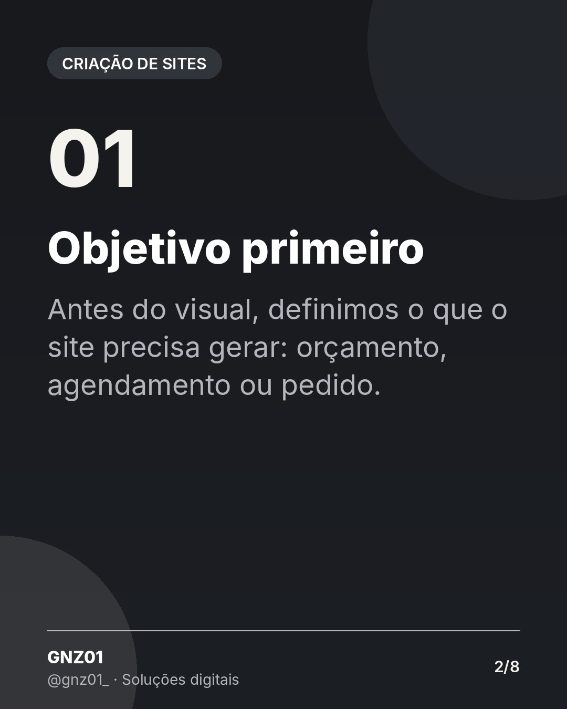
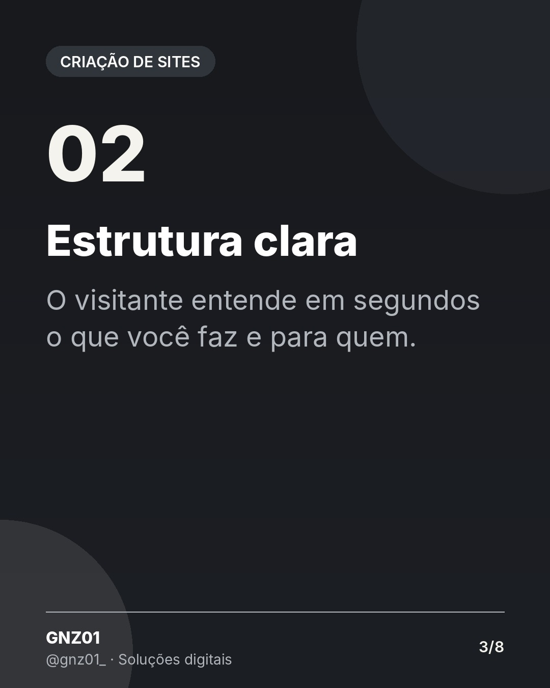
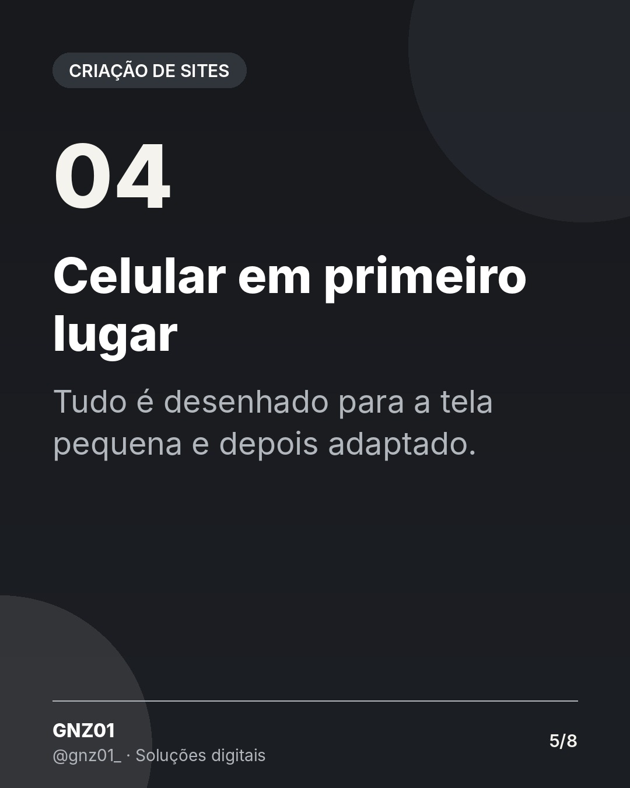
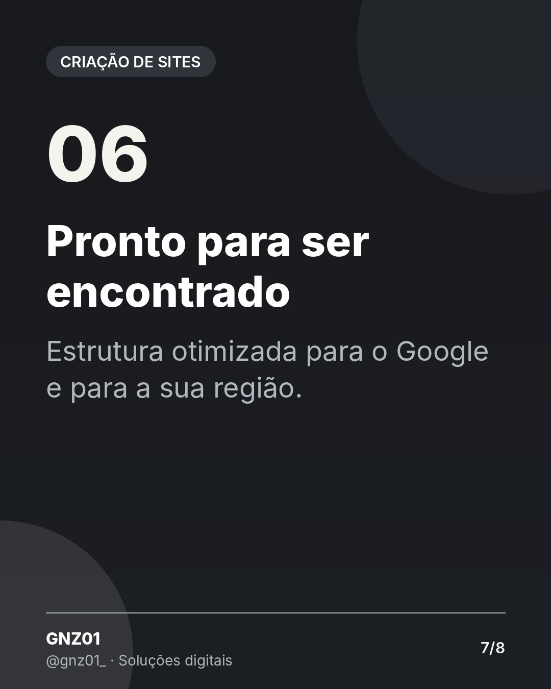

# Como pensamos um site que gera contato

- **Data e hora:** 10/11 (terça), 12:00
- **Formato:** Carrossel (8 slides)
- **Serviço:** Criação de sites
- **Pilar:** Autoridade
- **Nicho:** Geral
- **Público-alvo:** Quem está comparando fornecedores de site
- **Objetivo:** Mostrar o método da GNZ01 e diferenciar de sites genéricos.
- **Técnica de copy:** Gatilho de autoridade + processo
- **Palavras-chave (SEO):** site que gera clientes, como fazer um site profissional, agência de sites
- **CTA:** Solicite um orçamento personalizado
- **Status:** aguardando aprovação

## Texto da arte

1. **Capa:** Como pensamos um site que gera contato / Bonito é o mínimo. Ele precisa funcionar.
2. **Objetivo primeiro**: Antes do visual, definimos o que o site precisa gerar: orçamento, agendamento ou pedido.
3. **Estrutura clara**: O visitante entende em segundos o que você faz e para quem.
4. **Texto que conversa**: Escrevemos pensando nas dúvidas reais do seu cliente.
5. **Celular em primeiro lugar**: Tudo é desenhado para a tela pequena e depois adaptado.
6. **Caminho até você**: WhatsApp e contato sempre a um toque, em todas as páginas.
7. **Pronto para ser encontrado**: Estrutura otimizada para o Google e para a sua região.
8. **Final:** Quer um site pensado assim? + botão WhatsApp

## Direção de arte

Carrossel escuro, títulos fortes e frases curtas, numeração off-white.
Layout: padrão, fundo escuro (preto/grafite).

## Legenda completa

```
Um site bonito que não gera contato é só um cartão de visitas caro. 💼

Arrasta para o lado e veja como a GNZ01 pensa cada projeto: do objetivo à última linha de texto, tudo para levar o visitante até você.

👉 Solicite um orçamento personalizado: (19) 97829-9585
.
.
#criacaodesites #webdesigner #estrategiadigital #sitesparaempresas #sitesparapequenasempresas #facaseusite #siteresponsivo #webdesignerbrasil #orcamentodesite #siteprofissional #marketingdigital #empreendedorismo
```

## Criativos









