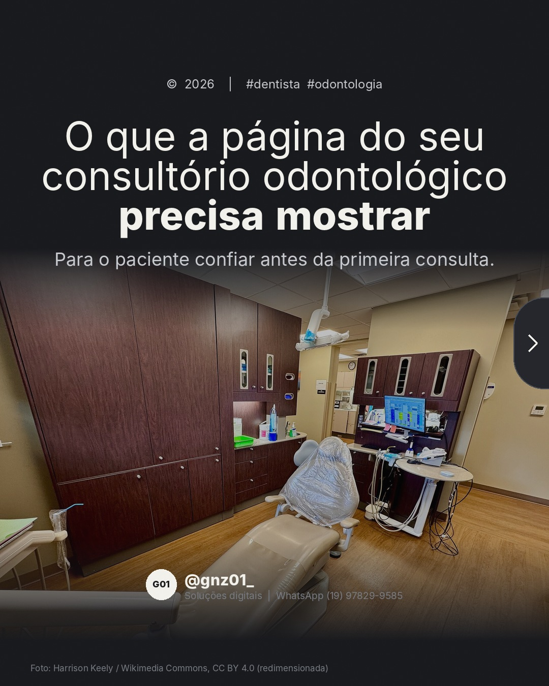
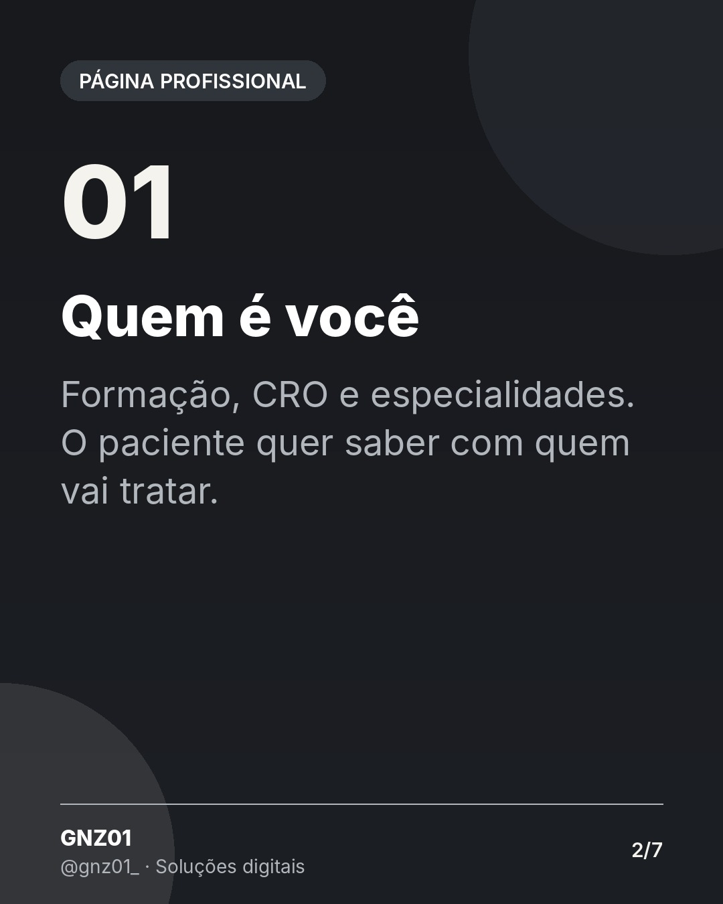
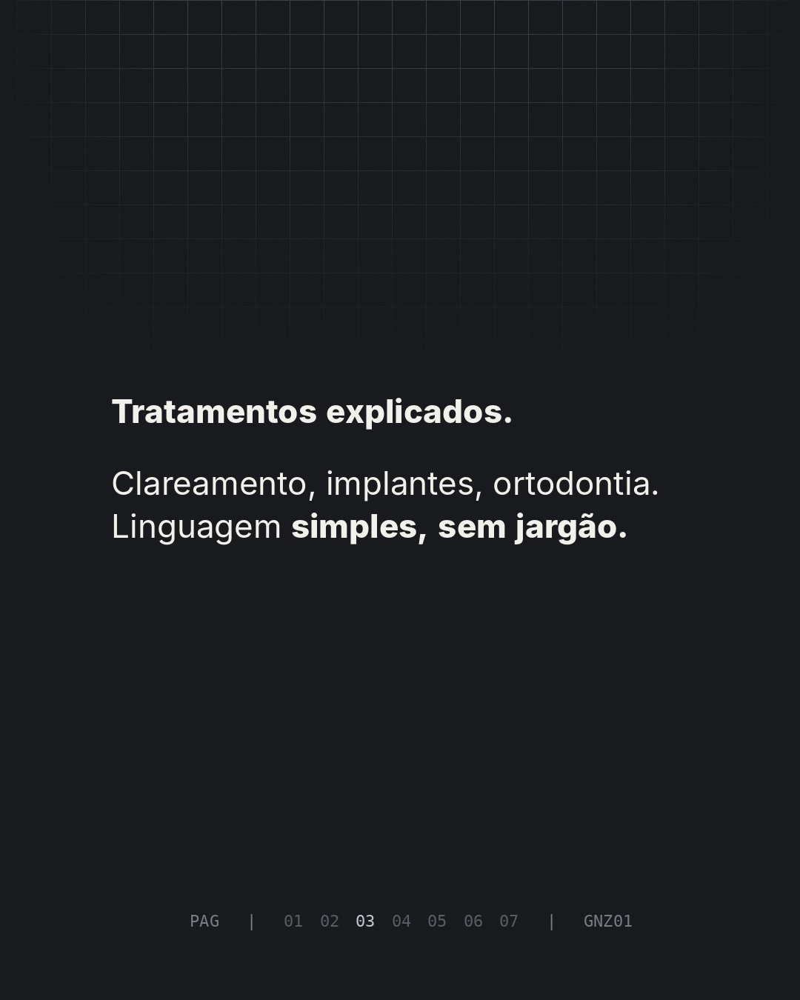
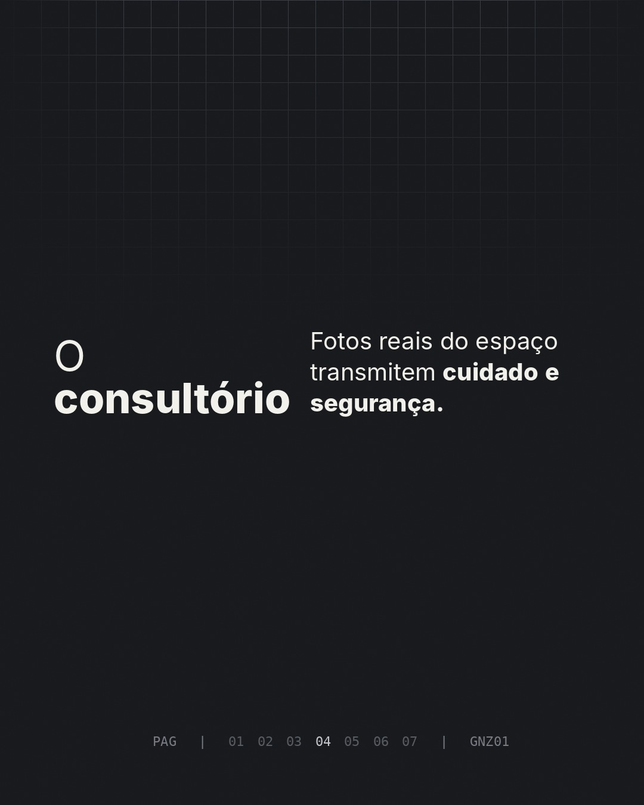
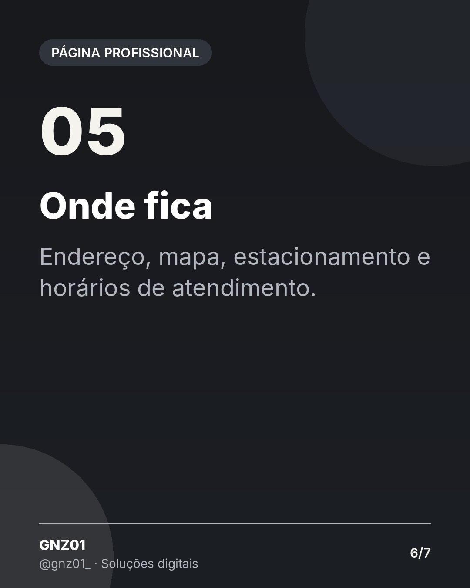

# O que a página do seu consultório odontológico precisa mostrar

- **Data e hora:** 12/11 (quinta), 12:00
- **Formato:** Carrossel (7 slides)
- **Serviço:** Página profissional
- **Pilar:** Demonstração
- **Nicho:** Clínicas odontológicas
- **Público-alvo:** Dentistas e clínicas odontológicas
- **Objetivo:** Conteúdo de nicho para dentistas, mostrando o que uma página deve ter.
- **Técnica de copy:** Nicho + checklist
- **Palavras-chave (SEO):** site para dentista, página para consultório odontológico, marketing odontológico
- **CTA:** Solicite um orçamento personalizado
- **Status:** agendado


## Texto da arte

1. **Capa:** O que a página do seu consultório odontológico precisa mostrar / Para o paciente confiar antes da primeira consulta.
2. **Quem é você**: Formação, CRO e especialidades. O paciente quer saber com quem vai tratar.
3. **Tratamentos explicados**: Clareamento, implantes, ortodontia. Linguagem simples, sem jargão.
4. **O consultório**: Fotos reais do espaço transmitem cuidado e segurança.
5. **Como agendar**: Agenda online ou botão de WhatsApp, sem o paciente precisar procurar.
6. **Onde fica**: Endereço, mapa, estacionamento e horários de atendimento.
7. **Final:** Quer a página do seu consultório assim? + botão WhatsApp

## Direção de arte

Carrossel escuro sóbrio, tom institucional, numeração off-white.
Layout: padrão, fundo escuro (preto/grafite).

## Legenda completa

```
Antes de marcar a primeira consulta, o paciente pesquisa. E decide se confia em você pelo que encontra. 🦷

Arrasta para o lado e veja o que a página do seu consultório precisa mostrar para transformar pesquisa em agendamento.

Para dentistas e clínicas odontológicas que querem uma presença à altura do seu trabalho.

👉 Solicite um orçamento personalizado: (19) 97829-9585
.
.
#dentista #odontologia #clinicaodontologica #marketingodontologico #paginaprofissional #profissionalliberal #presencadigital #criacaodesites #siteprofissional #sitesparaempresas #marketingdigital #empreendedorismo
```

## Criativos








