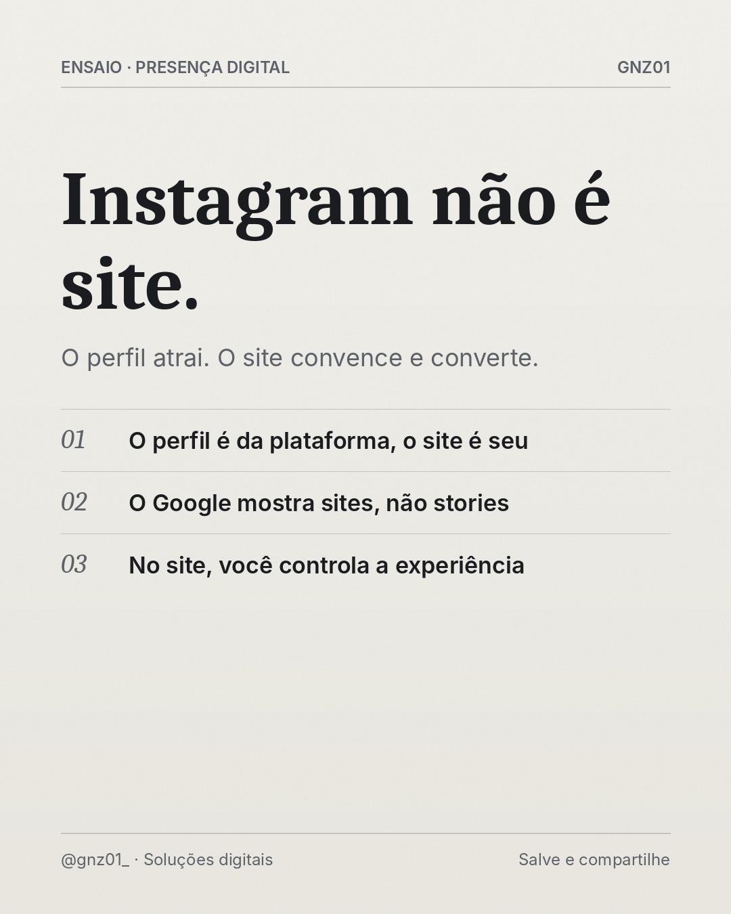

# Instagram não é site.

- **Data e hora:** 07/11 (sábado), 08:00
- **Formato:** Post único 1080x1350
- **Serviço:** Criação de sites
- **Pilar:** Educação
- **Nicho:** Comerciantes e autônomos
- **Público-alvo:** Negócios que vendem só pelo Instagram
- **Objetivo:** Quebrar a objeção 'já tenho Instagram, não preciso de site'.
- **Técnica de copy:** Quebra de objeção
- **Palavras-chave (SEO):** site ou Instagram, site para negócio, presença digital
- **CTA:** Solicite um orçamento personalizado
- **Status:** agendado


## Texto da arte

**Instagram não é site.**
O perfil atrai. O site convence e converte.
- O perfil é da plataforma, o site é seu
- O Google mostra sites, não stories
- No site, você controla a experiência

## Direção de arte

Editorial de revista: serifada Caladea para a frase de impacto, Inter para apoio, fios finos, numeração em itálico, grão fotográfico sutil. Fundo papel off-white. Pronto para receber fotografia real licenciada (campo foto) quando disponível.
Layout: editorial, fundo claro (off-white).

## Legenda completa

```
"Mas eu já tenho Instagram." Ótimo, ele é essencial. Só que ele não faz tudo. 📲

O Instagram é a vitrine que atrai. O site é o lugar onde o cliente entende o que você faz, confia e decide falar com você. E é ele que aparece quando alguém pesquisa no Google.

Os dois juntos formam a estratégia completa.

👉 Quer um site que trabalhe junto com o seu perfil? (19) 97829-9585
.
.
#criacaodesites #marketingdigital #instagramparanegocios #siteprofissional #sitesparapequenasempresas #facaseusite #siteresponsivo #webdesignerbrasil #orcamentodesite #sitesparaempresas #empreendedorismo
```

## Criativos


