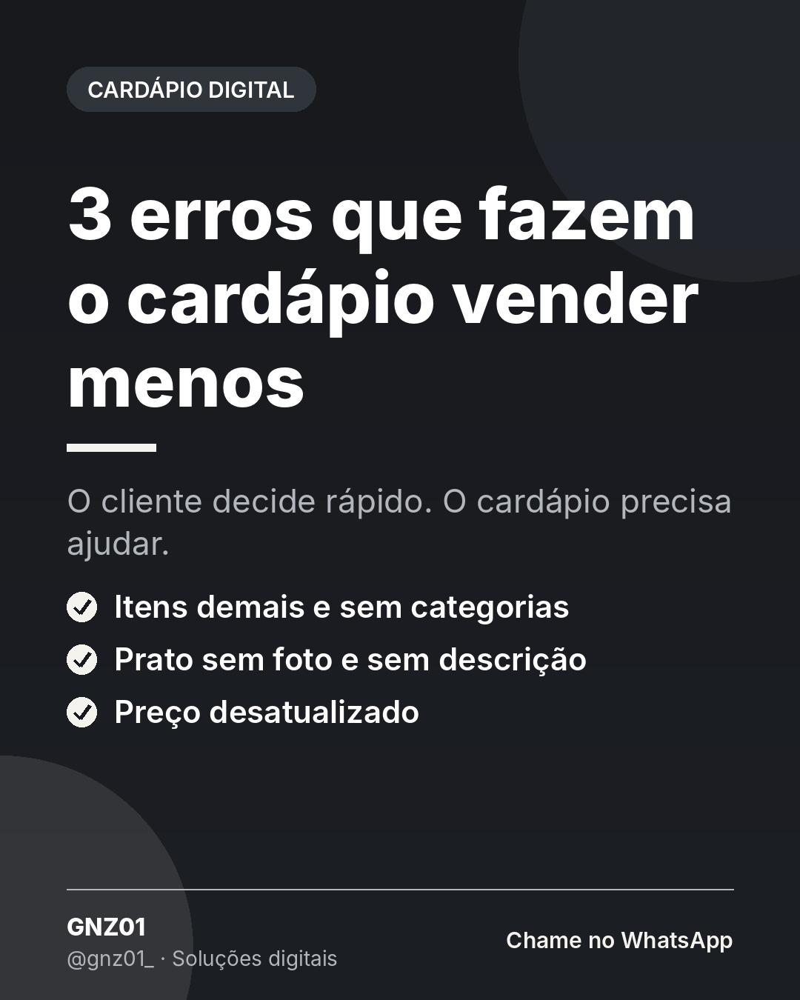

# 3 erros que fazem o cardápio vender menos

- **Data e hora:** 07/11 (sábado), 18:30
- **Formato:** Post único 1080x1350
- **Serviço:** Cardápio digital
- **Pilar:** Educação
- **Nicho:** Restaurantes, lanchonetes e pizzarias
- **Público-alvo:** Donos de restaurante e delivery
- **Objetivo:** Educar sobre erros de cardápio e posicionar a GNZ01 como especialista.
- **Técnica de copy:** PAS
- **Palavras-chave (SEO):** cardápio que vende, cardápio digital, erros no cardápio
- **CTA:** Solicite um orçamento personalizado
- **Status:** aguardando aprovação

## Texto da arte

**3 erros que fazem o cardápio vender menos**
O cliente decide rápido. O cardápio precisa ajudar.
- Itens demais e sem categorias
- Prato sem foto e sem descrição
- Preço desatualizado

## Direção de arte

Padrão escuro, título forte, três erros listados com marcador off-white.
Layout: padrao, fundo escuro (preto/grafite).

## Legenda completa

```
O cliente abre o cardápio com fome e pouca paciência. 🍔

Se ele precisa procurar demais, não entende o prato ou descobre outro preço na hora de pagar, a venda fica menor, ou nem acontece.

No cardápio digital, você organiza por categorias, coloca foto e descrição em cada item e atualiza preços em segundos.

👉 Quer revisar o seu cardápio com a gente? (19) 97829-9585

💻 Também crio sites profissionais para o seu negócio aparecer no Google. Peça seu orçamento: (19) 97829-9585
.
.
#cardapiodigital #restaurante #gestaoderestaurante #lanchonete #cardapioonline #pedidopelowhatsapp #donoderestaurante #criacaodesites #siteprofissional #sitesparaempresas #marketingdigital #empreendedorismo
```

## Criativos


