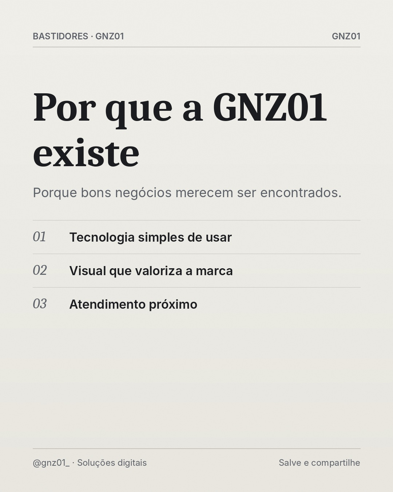

# Por que a GNZ01 existe

- **Data e hora:** 08/11 (domingo), 15:00
- **Formato:** Post único 1080x1350
- **Serviço:** Gnz01
- **Pilar:** Conexão
- **Nicho:** Geral
- **Público-alvo:** Seguidores e visitantes do perfil
- **Objetivo:** Criar conexão contando o propósito da GNZ01.
- **Técnica de copy:** Storytelling
- **Palavras-chave (SEO):** GNZ01, história da marca, soluções digitais
- **CTA:** Envie uma mensagem pelo Direct
- **Status:** agendado


## Texto da arte

**Por que a GNZ01 existe**
Porque bons negócios merecem ser encontrados.
- Tecnologia simples de usar
- Visual que valoriza a marca
- Atendimento próximo

## Direção de arte

Editorial de revista: serifada Caladea para a frase de impacto, Inter para apoio, fios finos, numeração em itálico, grão fotográfico sutil. Fundo papel off-white. Pronto para receber fotografia real licenciada (campo foto) quando disponível.
Layout: editorial, fundo escuro (preto/grafite).

## Legenda completa

```
A GNZ01 nasceu de uma observação simples: muitos negócios excelentes perdem clientes não pela qualidade do trabalho, mas pela forma como aparecem na internet. 💡

A barbearia cheia de clientes fiéis que ninguém novo encontra. O restaurante com comida incrível e pedidos anotados no papel. A profissional talentosa que passa a noite respondendo mensagem para marcar horário.

Nosso trabalho é resolver isso com soluções digitais simples, bonitas e que funcionam no dia a dia.

Se você se identificou com algum desses exemplos, me conta no Direct. 💬
.
.
#gnz01 #empreendedorismo #solucoesdigitais #negociolocal #criacaodesites #siteprofissional #sitesparaempresas #marketingdigital
```

## Criativos


