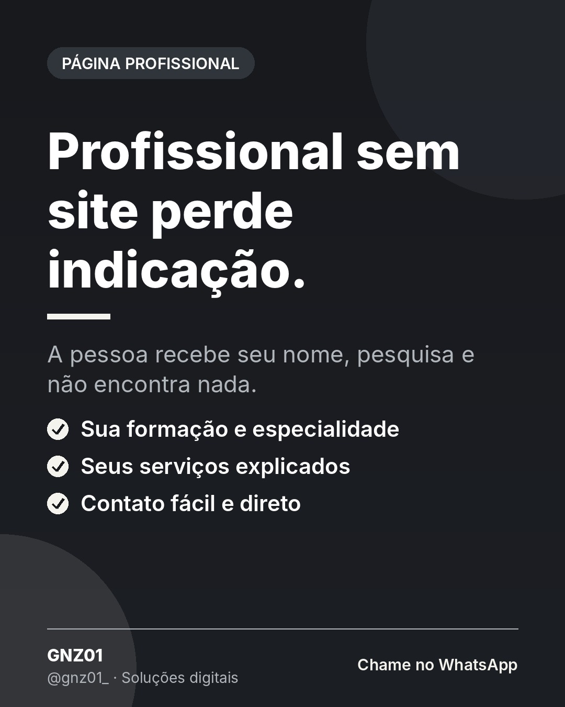

# Profissional sem site perde indicação.

- **Data e hora:** 09/11 (segunda), 08:00
- **Formato:** Post único 1080x1350
- **Serviço:** Página profissional
- **Pilar:** Educação
- **Nicho:** Profissionais autônomos e liberais
- **Público-alvo:** Advogados, psicólogos, dentistas, arquitetos, consultores
- **Objetivo:** Mostrar que a indicação se perde sem presença digital.
- **Técnica de copy:** Storytelling curto + PAS
- **Palavras-chave (SEO):** site para profissional liberal, página profissional, site para psicólogo
- **CTA:** Solicite um orçamento personalizado
- **Status:** aguardando aprovação

## Texto da arte

**Profissional sem site perde indicação.**
A pessoa recebe seu nome, pesquisa e não encontra nada.
- Sua formação e especialidade
- Seus serviços explicados
- Contato fácil e direto

## Direção de arte

Padrão escuro, sóbrio, título forte. Tom mais institucional.
Layout: padrao, fundo escuro (preto/grafite).

## Legenda completa

```
Alguém indica você. A pessoa anota seu nome, pesquisa no Google... e encontra pouco ou nada. 🔎

Nesse momento, a indicação perde força. A confiança que veio do amigo não encontra confirmação.

Uma página profissional mostra sua formação, sua especialidade, como você trabalha e como agendar. Ela transforma indicação em cliente.

👉 Para advogados, psicólogos, dentistas, nutricionistas, arquitetos e consultores: (19) 97829-9585
.
.
#paginaprofissional #profissionalliberal #psicologos #advogados #presencadigital #criacaodesites #siteprofissional #sitesparaempresas #marketingdigital #empreendedorismo
```

## Criativos


