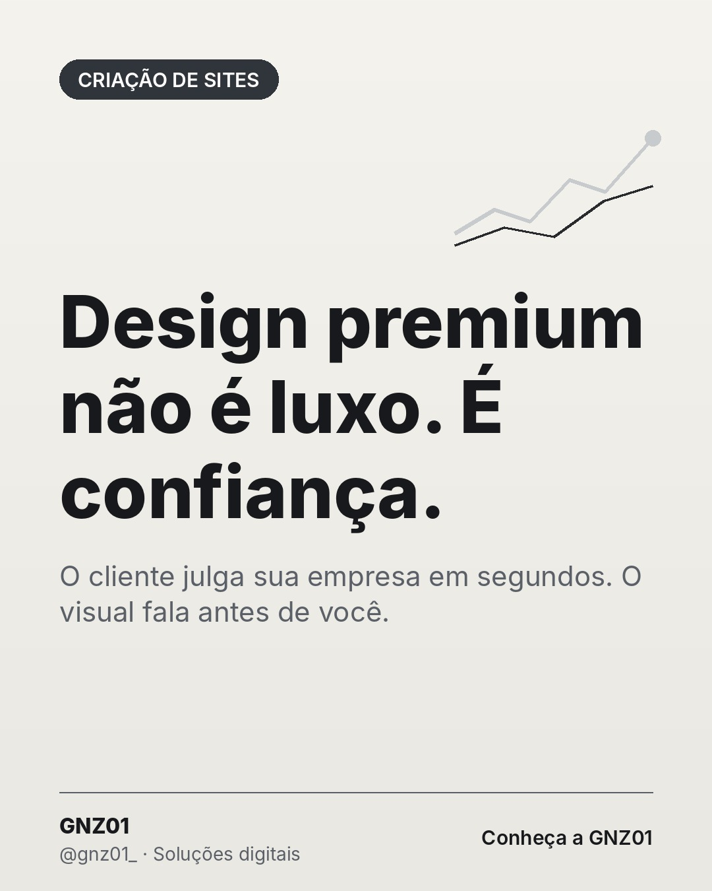

# Design premium não é luxo. É confiança.

- **Data e hora:** 09/11 (segunda), 15:00
- **Formato:** Post único 1080x1350
- **Serviço:** Criação de sites
- **Pilar:** Autoridade
- **Nicho:** Geral
- **Público-alvo:** Empresas que querem se diferenciar
- **Objetivo:** Posicionar o design premium como fator de confiança e valor.
- **Técnica de copy:** Gatilho de autoridade
- **Palavras-chave (SEO):** design de site profissional, site bonito, valorizar a marca
- **CTA:** Conheça nossas soluções
- **Status:** agendado


## Texto da arte

**Design premium não é luxo. É confiança.**
O cliente julga sua empresa em segundos. O visual fala antes de você.

## Direção de arte

Layout pergunta em versão clara, título centralizado grande, quase sem elementos. Elegância pelo vazio.
Layout: pergunta, fundo claro (off-white).

## Legenda completa

```
Antes de ler uma palavra, o visitante já formou uma impressão. ✨

Um site com visual descuidado passa a sensação de um serviço descuidado, mesmo quando o trabalho é excelente. Um visual limpo, organizado e profissional faz o contrário: transmite segurança e valoriza o seu preço.

É por isso que cada projeto da GNZ01 tem estética minimalista, tipografia cuidada e foco total na experiência do cliente.

👉 Conheça nossas soluções: (19) 97829-9585
.
.
#webdesign #designpremium #criacaodesites #branding #sitesparapequenasempresas #facaseusite #siteresponsivo #webdesignerbrasil #orcamentodesite #siteprofissional #sitesparaempresas #marketingdigital #empreendedorismo
```

## Criativos


