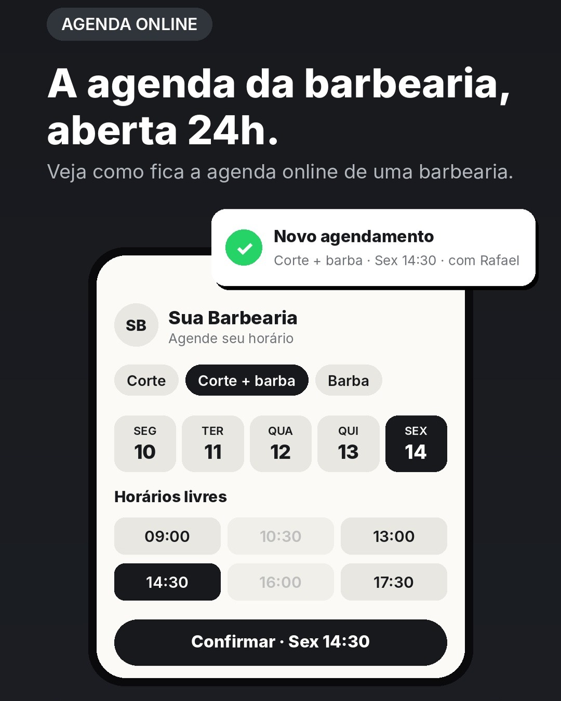

# Veja como fica a agenda online de uma barbearia

- **Data e hora:** 10/11 (terça), 08:00
- **Formato:** Post único 1080x1350
- **Serviço:** Agenda online
- **Pilar:** Demonstração
- **Nicho:** Barbearias
- **Público-alvo:** Donos de barbearia
- **Objetivo:** Mostrar a agenda funcionando para gerar desejo em barbeiros.
- **Técnica de copy:** Demonstração
- **Palavras-chave (SEO):** agenda online barbearia, agendamento barbearia, sistema para barbearia
- **CTA:** Solicite uma demonstração
- **Status:** aguardando aprovação

## Texto da arte

Demonstração de agenda em celular: **A agenda da barbearia, aberta 24h.** / Veja como fica a agenda online de uma barbearia.
Nome fictício: Sua Barbearia (marcado como imagem ilustrativa)

## Direção de arte

Mockup de celular com a agenda, notificação de novo agendamento, nota de imagem ilustrativa.
Layout: vitrine (mockup de celular), fundo escuro (preto/grafite).

## Legenda completa

```
Cliente quer cortar sexta às 14h30 com o mesmo barbeiro de sempre. Ele abre o link, escolhe o serviço, o profissional e o horário. Pronto. 💈

Você recebe o aviso, ele recebe o lembrete, e ninguém precisou trocar mensagem.

Esta é uma demonstração de como fica. A da sua barbearia sai com o seu nome, seus serviços, seus preços e sua equipe.

👉 Solicite uma demonstração: (19) 97829-9585

💻 Também crio sites profissionais para o seu negócio aparecer no Google. Peça seu orçamento: (19) 97829-9585
.
.
#barbearia #barbershop #agendaonline #barbeiro #agendamentoonline #sistemadeagendamento #profissionaldabeleza #criacaodesites #siteprofissional #sitesparaempresas #marketingdigital #empreendedorismo
```

## Criativos


