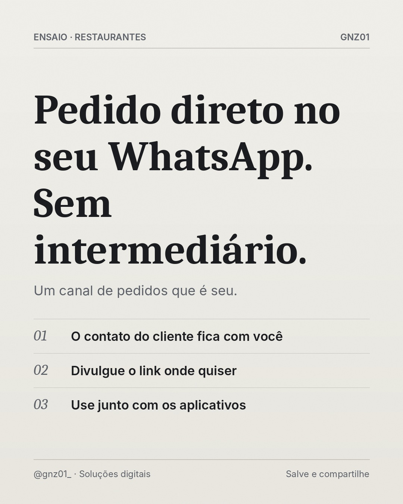

# Pedido direto no seu WhatsApp. Sem intermediário.

- **Data e hora:** 10/11 (terça), 15:00
- **Formato:** Post único 1080x1350
- **Serviço:** Cardápio digital
- **Pilar:** Demonstração
- **Nicho:** Delivery e lanchonetes
- **Público-alvo:** Deliveries que dependem de aplicativos
- **Objetivo:** Mostrar o benefício de ter um canal próprio de pedidos.
- **Técnica de copy:** Comparação + benefício
- **Palavras-chave (SEO):** delivery próprio, pedido pelo WhatsApp, cardápio digital delivery
- **CTA:** Veja como funciona
- **Status:** agendado


## Texto da arte

**Pedido direto no seu WhatsApp. Sem intermediário.**
Um canal de pedidos que é seu.
- O contato do cliente fica com você
- Divulgue o link onde quiser
- Use junto com os aplicativos

## Direção de arte

Editorial de revista: serifada Caladea para a frase de impacto, Inter para apoio, fios finos, numeração em itálico, grão fotográfico sutil. Fundo papel off-white. Pronto para receber fotografia real licenciada (campo foto) quando disponível.
Layout: editorial, fundo claro (off-white).

## Legenda completa

```
Os aplicativos de delivery ajudam a ser encontrado. Mas o cliente que já te conhece pode pedir direto com você. 🛵

Com um cardápio digital próprio, o pedido chega no seu WhatsApp e o contato do cliente fica com você, para fidelizar e avisar de promoções.

A estratégia que funciona: app para ser descoberto, canal próprio para fidelizar.

👉 Veja como funciona: (19) 97829-9585

💻 Também crio sites profissionais para o seu negócio aparecer no Google. Peça seu orçamento: (19) 97829-9585
.
.
#cardapiodigital #delivery #pedidopelowhatsapp #hamburgueria #cardapioonline #donoderestaurante #criacaodesites #siteprofissional #sitesparaempresas #marketingdigital #empreendedorismo
```

## Criativos


