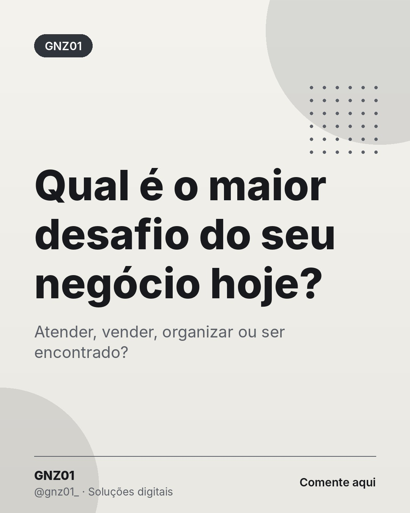

# Qual é o maior desafio do seu negócio hoje?

- **Data e hora:** 10/11 (terça), 21:00
- **Formato:** Post único 1080x1350
- **Serviço:** Gnz01
- **Pilar:** Conexão
- **Nicho:** Geral
- **Público-alvo:** Seguidores
- **Objetivo:** Gerar comentários e entender as dores do público.
- **Técnica de copy:** Pergunta aberta
- **Palavras-chave (SEO):** desafios do pequeno negócio, empreender, soluções digitais
- **CTA:** Comente
- **Status:** aguardando aprovação

## Texto da arte

**Qual é o maior desafio do seu negócio hoje?**
Atender, vender, organizar ou ser encontrado?

## Direção de arte

Layout pergunta em versão clara, título centralizado.
Layout: pergunta, fundo claro (off-white).

## Legenda completa

```
Pergunta sincera: qual é o maior desafio do seu negócio hoje? 🤔

1️⃣ Ser encontrado por novos clientes
2️⃣ Dar conta das mensagens
3️⃣ Organizar pedidos ou agenda
4️⃣ Passar uma imagem mais profissional

Comenta o número. As respostas vão guiar os próximos conteúdos daqui. 👇
.
.
#empreendedorismo #pequenosnegocios #gnz01 #gestao #solucoesdigitais #criacaodesites #siteprofissional #sitesparaempresas #marketingdigital
```

## Criativos


