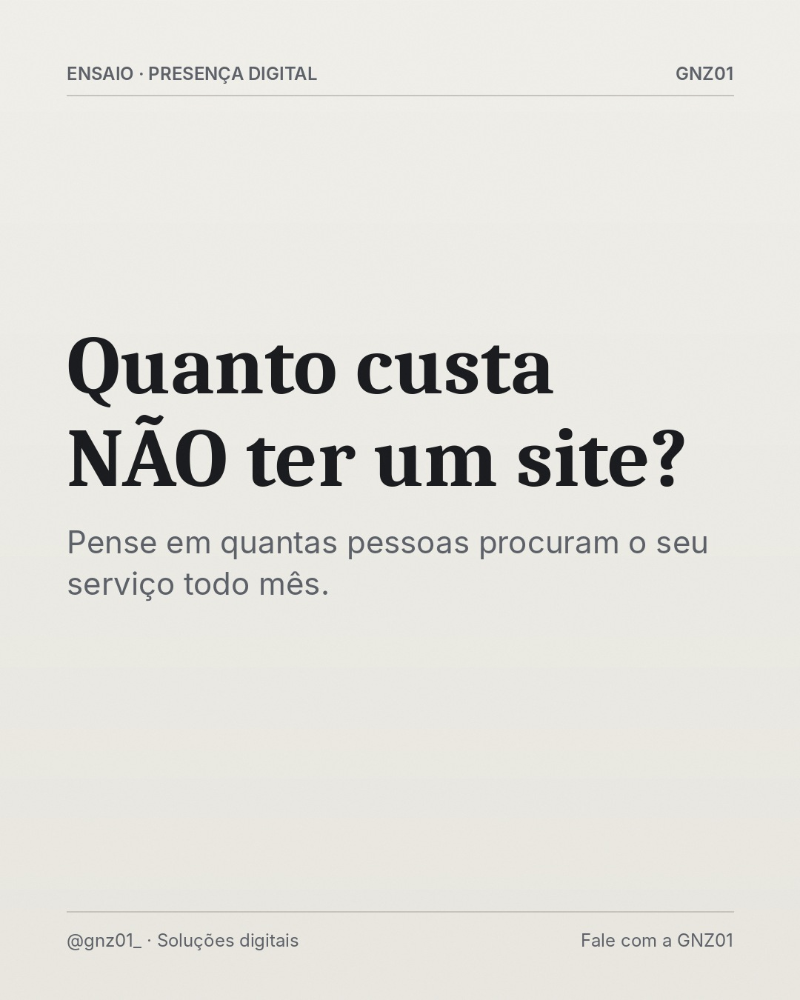

# Quanto custa NÃO ter um site?

- **Data e hora:** 11/11 (quarta), 08:00
- **Formato:** Post único 1080x1350
- **Serviço:** Criação de sites
- **Pilar:** Educação
- **Nicho:** Pequenos e médios comerciantes
- **Público-alvo:** Quem acha site caro
- **Objetivo:** Fazer o dono do negócio pensar no custo de oportunidade.
- **Técnica de copy:** Quebra de objeção
- **Palavras-chave (SEO):** quanto custa um site, vale a pena ter site, site para empresa
- **CTA:** Solicite um orçamento personalizado
- **Status:** agendado


## Texto da arte

**Quanto custa NÃO ter um site?**
Pense em quantas pessoas procuram o seu serviço todo mês.

## Direção de arte

Editorial de revista: serifada Caladea para a frase de impacto, Inter para apoio, fios finos, numeração em itálico, grão fotográfico sutil. Fundo papel off-white. Pronto para receber fotografia real licenciada (campo foto) quando disponível.
Layout: editorial, fundo escuro (preto/grafite).

## Legenda completa

```
A pergunta costuma ser "quanto custa um site?". A pergunta certa talvez seja outra. 💭

Quantas pessoas procuram o seu serviço na sua cidade todo mês? Quantas delas encontram o concorrente primeiro? Quanto vale um cliente novo para você?

Um site é um investimento que trabalha todos os dias. Poucos clientes novos já fazem diferença no fim do ano.

👉 Solicite um orçamento personalizado e compare: (19) 97829-9585
.
.
#criacaodesites #investimento #empreendedorismo #sitesparaempresas #sitesparapequenasempresas #facaseusite #siteresponsivo #webdesignerbrasil #orcamentodesite #siteprofissional #marketingdigital
```

## Criativos


