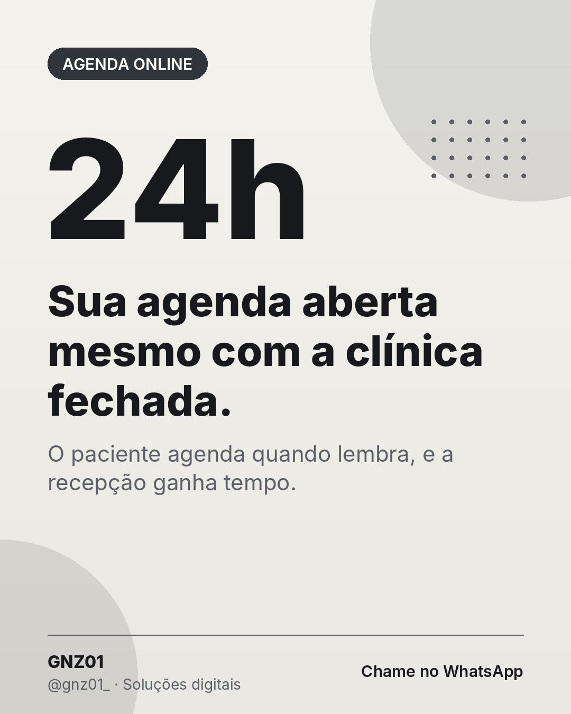

# Sua agenda aberta mesmo com a clínica fechada.

- **Data e hora:** 11/11 (quarta), 18:30
- **Formato:** Post único 1080x1350
- **Serviço:** Agenda online
- **Pilar:** Autoridade
- **Nicho:** Clínicas de estética e odontológicas
- **Público-alvo:** Clínicas e consultórios
- **Objetivo:** Posicionar a agenda online como padrão de atendimento moderno.
- **Técnica de copy:** Benefício + autoridade
- **Palavras-chave (SEO):** agenda online clínica, agendamento de consultas, sistema para clínica
- **CTA:** Solicite uma demonstração
- **Status:** aguardando aprovação

## Texto da arte

**24h Sua agenda aberta mesmo com a clínica fechada.**
O paciente agenda quando lembra, e a recepção ganha tempo.

## Direção de arte

Layout número em versão clara, '24h' gigante em preto, título abaixo.
Layout: numero, fundo claro (off-white).

## Legenda completa

```
Muitos pacientes lembram de marcar consulta à noite ou no fim de semana, justamente quando a recepção não está atendendo. 🌙

Com a agenda online, ele escolhe o profissional, o procedimento e o horário disponível na hora, e recebe lembrete antes da consulta.

Para clínicas odontológicas, de estética e consultórios que querem um atendimento mais moderno.

👉 Solicite uma demonstração: (19) 97829-9585

💻 Também crio sites profissionais para o seu negócio aparecer no Google. Peça seu orçamento: (19) 97829-9585
.
.
#clinicadeestetica #odontologia #agendaonline #consultorio #agendamentoonline #sistemadeagendamento #profissionaldabeleza #criacaodesites #siteprofissional #sitesparaempresas #marketingdigital #empreendedorismo
```

## Criativos


