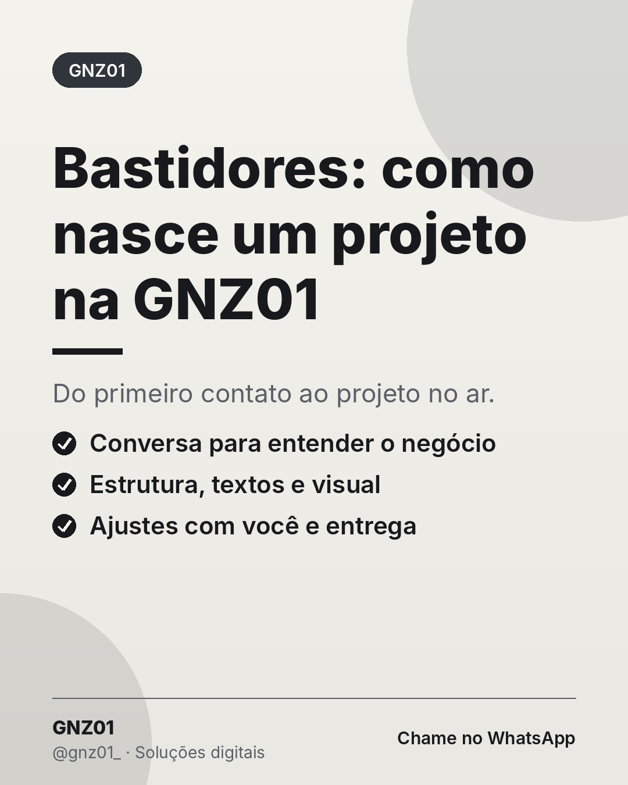

# Bastidores: como nasce um projeto na GNZ01

- **Data e hora:** 12/11 (quinta), 08:00
- **Formato:** Post único 1080x1350
- **Serviço:** Gnz01
- **Pilar:** Conexão
- **Nicho:** Geral
- **Público-alvo:** Potenciais clientes avaliando a GNZ01
- **Objetivo:** Mostrar o processo e gerar confiança com bastidores.
- **Técnica de copy:** Storytelling de bastidor
- **Palavras-chave (SEO):** como é feito um site, processo de criação de site, GNZ01
- **CTA:** Envie uma mensagem pelo Direct
- **Status:** aguardando aprovação

## Texto da arte

**Bastidores: como nasce um projeto na GNZ01**
Do primeiro contato ao projeto no ar.
- Conversa para entender o negócio
- Estrutura, textos e visual
- Ajustes com você e entrega

## Direção de arte

Versão clara, título de bastidor, três etapas com check.
Layout: padrao, fundo claro (off-white).

## Legenda completa

```
Já se perguntou como um projeto sai do zero até estar no ar? 🛠️

1️⃣ Começa com uma conversa: quem é seu cliente, o que você vende, o que precisa melhorar.
2️⃣ Definimos a estrutura e os textos pensando nas dúvidas reais de quem compra de você.
3️⃣ Criamos o visual com a identidade do seu negócio.
4️⃣ Você revisa, ajustamos juntos e colocamos no ar.

Simples para você, cuidadoso do nosso lado.

💬 Tem um projeto em mente? Me conta no Direct ou no WhatsApp: (19) 97829-9585
.
.
#bastidores #gnz01 #webdesign #processocriativo #solucoesdigitais #criacaodesites #siteprofissional #sitesparaempresas #marketingdigital #empreendedorismo
```

## Criativos


