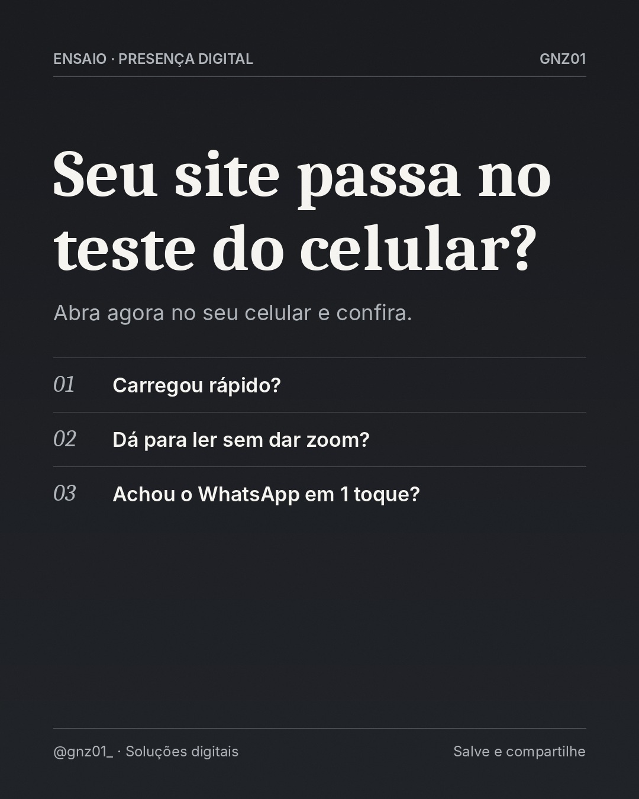

# Seu site passa no teste do celular?

- **Data e hora:** 12/11 (quinta), 15:00
- **Formato:** Post único 1080x1350
- **Serviço:** Criação de sites
- **Pilar:** Demonstração
- **Nicho:** Geral
- **Público-alvo:** Quem já tem site antigo
- **Objetivo:** Dar um teste prático que revela problemas no site atual.
- **Técnica de copy:** Teste prático + curiosidade
- **Palavras-chave (SEO):** site no celular, site responsivo, site lento
- **CTA:** Envie seu link pelo Direct
- **Status:** agendado


## Texto da arte

**Seu site passa no teste do celular?**
Abra agora no seu celular e confira.
- Carregou rápido?
- Dá para ler sem dar zoom?
- Achou o WhatsApp em 1 toque?

## Direção de arte

Editorial de revista: serifada Caladea para a frase de impacto, Inter para apoio, fios finos, numeração em itálico, grão fotográfico sutil. Fundo grafite. Pronto para receber fotografia real licenciada (campo foto) quando disponível.
Layout: editorial, fundo escuro (preto/grafite).

## Legenda completa

```
Faça agora: abra o seu site no celular, como se fosse um cliente. 📱

✔️ Carregou rápido?
✔️ Dá para ler sem dar zoom?
✔️ O botão de WhatsApp aparece fácil?

Se alguma resposta foi "não", o seu site pode estar perdendo visitantes antes mesmo de eles conhecerem o seu trabalho.

👉 Quer uma avaliação do seu site atual? Me manda o link no Direct ou no WhatsApp: (19) 97829-9585
.
.
#siteresponsivo #criacaodesites #experienciadousuario #webdesign #sitesparapequenasempresas #facaseusite #webdesignerbrasil #orcamentodesite #siteprofissional #sitesparaempresas #marketingdigital #empreendedorismo
```

## Criativos


