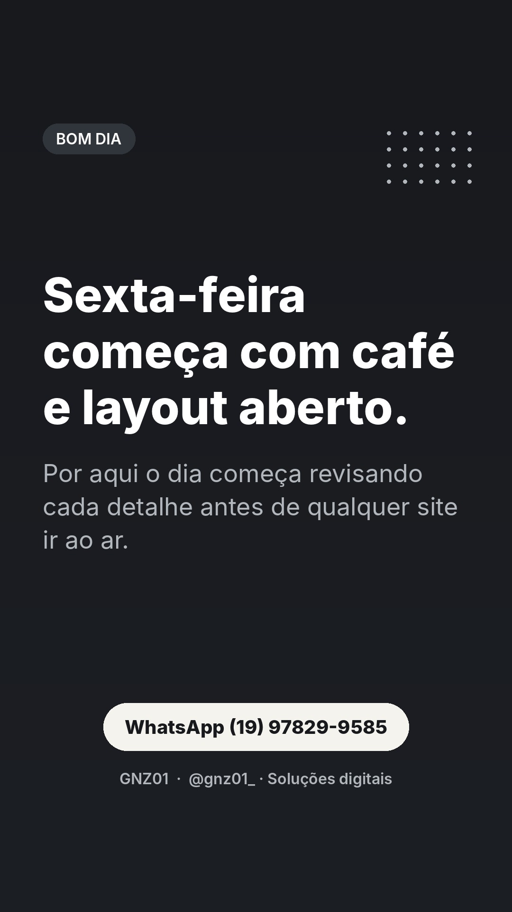
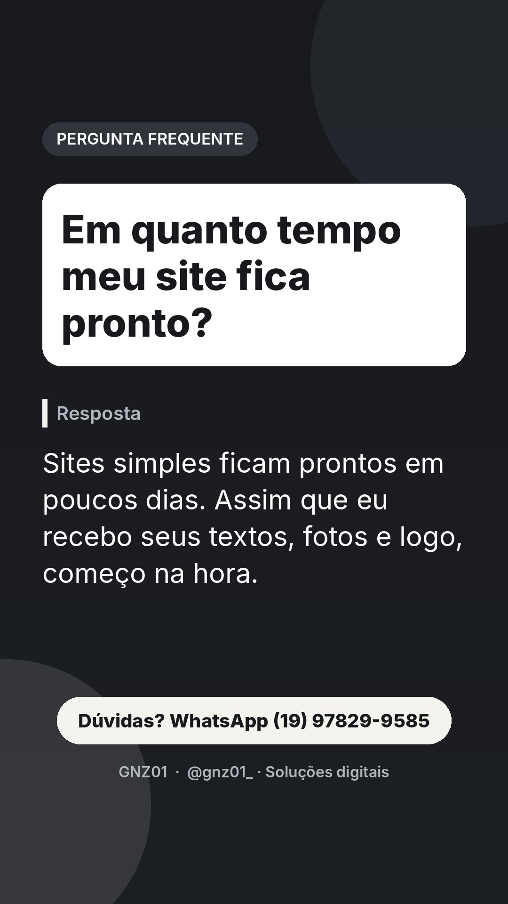
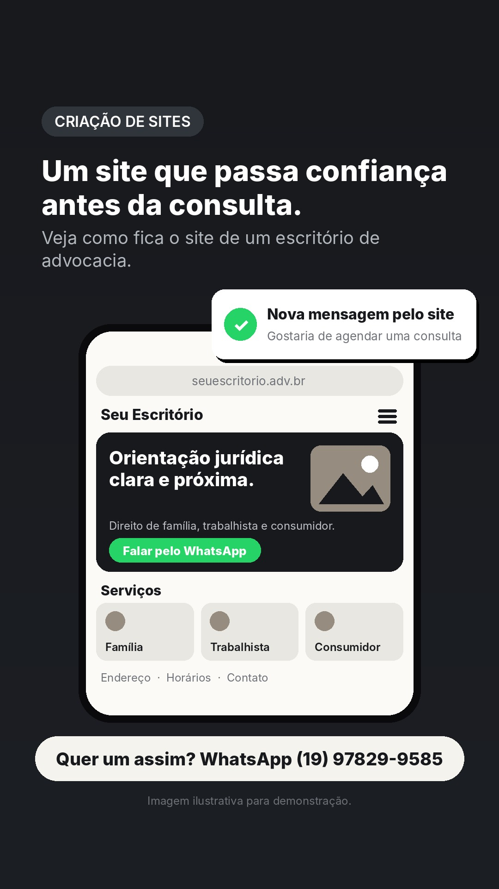
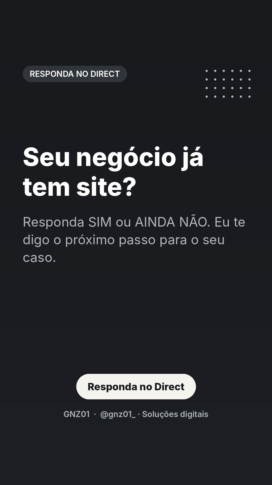
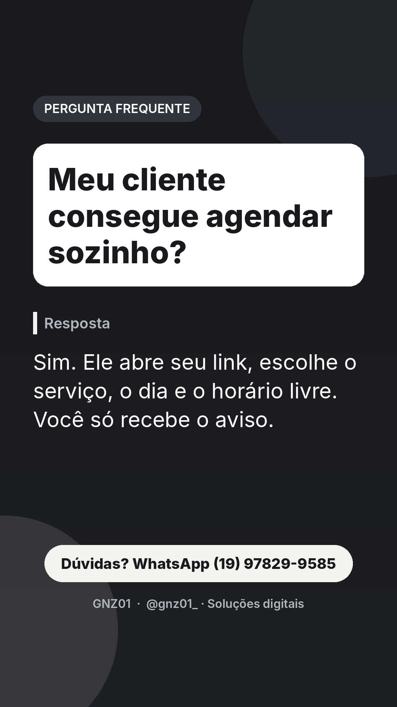
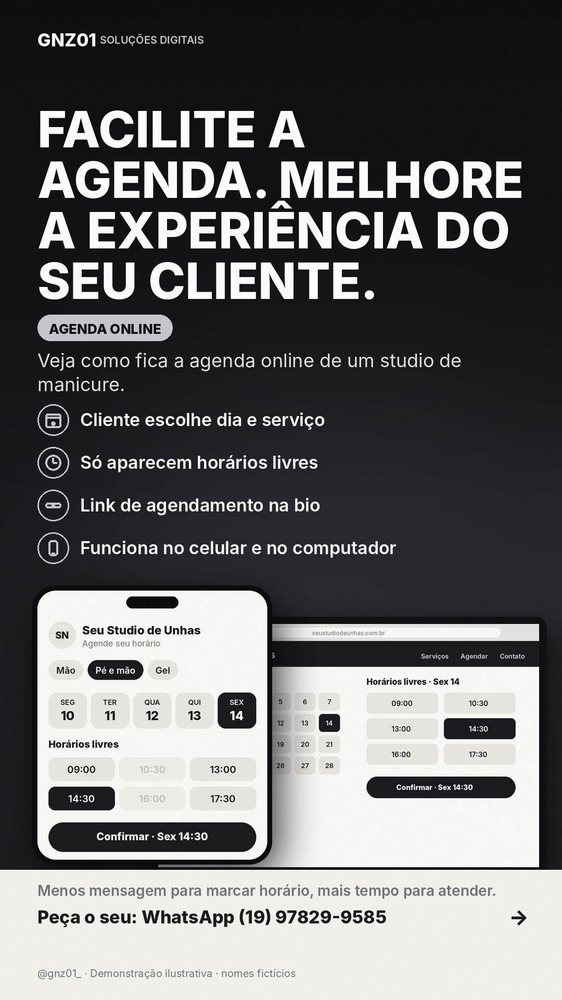

# Stories de 06/11 (sexta)

Funil do dia: conexão de manhã, dúvidas frequentes ao longo do dia, pergunta para o Direct, demonstração à noite e chamada para orçamento antes de dormir.

## 07:30 · Texto

**Sexta-feira começa com café e layout aberto.**
Por aqui o dia começa revisando cada detalhe antes de qualquer site ir ao ar.
CTA: WhatsApp (19) 97829-9585

## 09:30 · Pergunta frequente

**Em quanto tempo meu site fica pronto?**
CTA: Dúvidas? WhatsApp

## 11:00 · Demonstração: prévia de site

**Um site que passa confiança antes da consulta.**
Veja como fica o site de um escritório de advocacia.
CTA: Dúvidas? WhatsApp

## 13:30 · Texto

**Seu negócio já tem site?**
Responda SIM ou AINDA NÃO. Eu te digo o próximo passo para o seu caso.
CTA: Responda no Direct
Dica ao publicar manualmente: adicione a figurinha de enquete ou caixa de perguntas por cima (a API não permite figurinhas).

## 16:30 · Pergunta frequente

**Meu cliente consegue agendar sozinho?**
CTA: Dúvidas? WhatsApp

## 19:30 · Demonstração: agenda online

**Sua cliente marca a unha sozinha.**
Veja como fica a agenda online de um studio de manicure.
CTA: Quer um assim? WhatsApp

## 22:00 · Texto

**Seu site pode começar na próxima semana.**
Conte como é seu negócio e receba um orçamento personalizado, sem compromisso.
CTA: WhatsApp (19) 97829-9585

