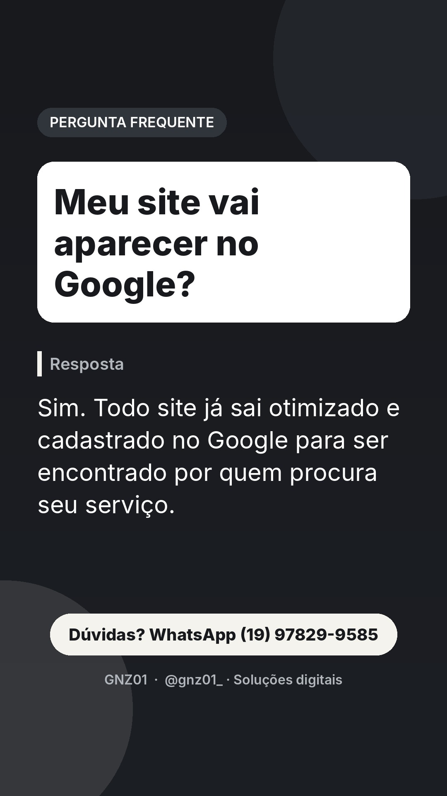
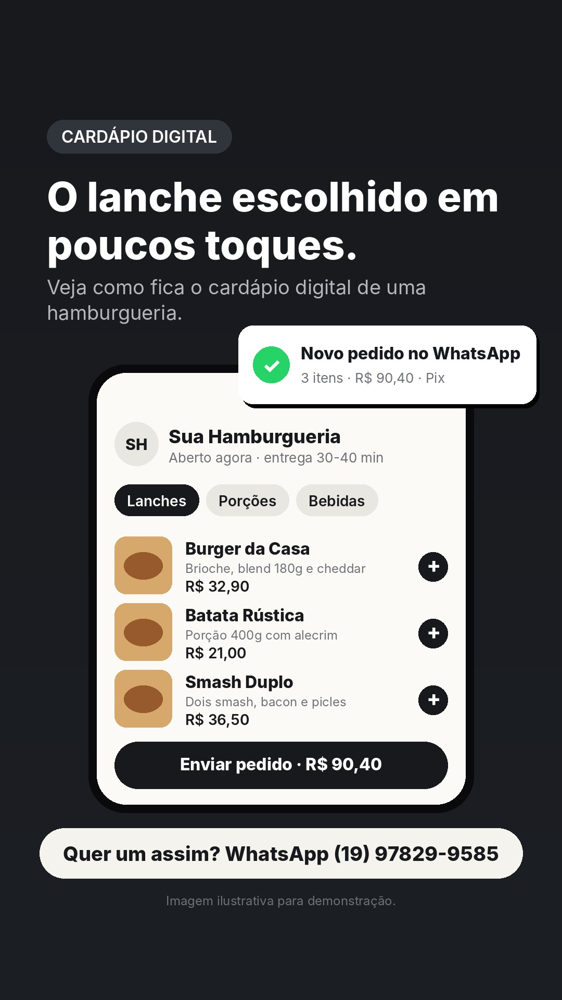

# Stories de 07/11 (sábado)

Funil do dia: conexão de manhã, dúvidas frequentes ao longo do dia, pergunta para o Direct, demonstração à noite e chamada para orçamento antes de dormir.

## 07:30 · Texto

**Antes do design, vem a conversa.**
Todo projeto da GNZ01 começa entendendo como o seu cliente compra de você.
CTA: WhatsApp (19) 97829-9585

## 09:30 · Pergunta frequente

**Preciso entender de tecnologia para ter um site?**
CTA: Dúvidas? WhatsApp

## 11:00 · Pergunta frequente

**Meu site vai aparecer no Google?**
CTA: Dúvidas? WhatsApp

## 13:30 · Texto

**Quantas vezes por dia você manda o mesmo preço no WhatsApp?**
Se a resposta for "muitas", um cardápio ou catálogo digital resolve.
CTA: Responda no Direct
Dica ao publicar manualmente: adicione a figurinha de enquete ou caixa de perguntas por cima (a API não permite figurinhas).

## 16:30 · Pergunta frequente

**Consigo mudar os preços do cardápio sozinho?**
CTA: Dúvidas? WhatsApp

## 19:30 · Demonstração: cardápio digital

**O lanche escolhido em poucos toques.**
Veja como fica o cardápio digital de uma hamburgueria.
CTA: Quer um assim? WhatsApp

## 22:00 · Texto

**Seu negócio merece uma vitrine profissional.**
Sites, cardápios, agendas e catálogos sob medida para o seu atendimento.
CTA: WhatsApp (19) 97829-9585

