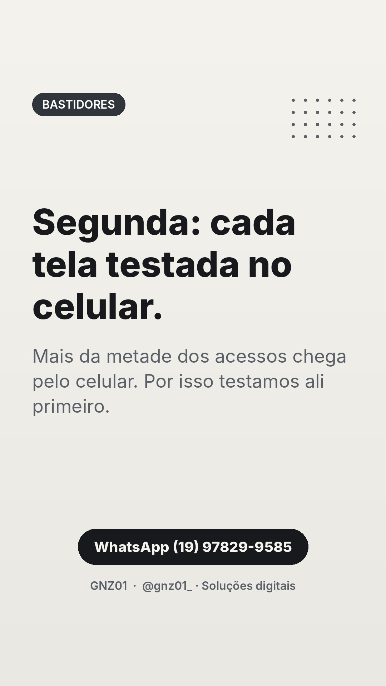
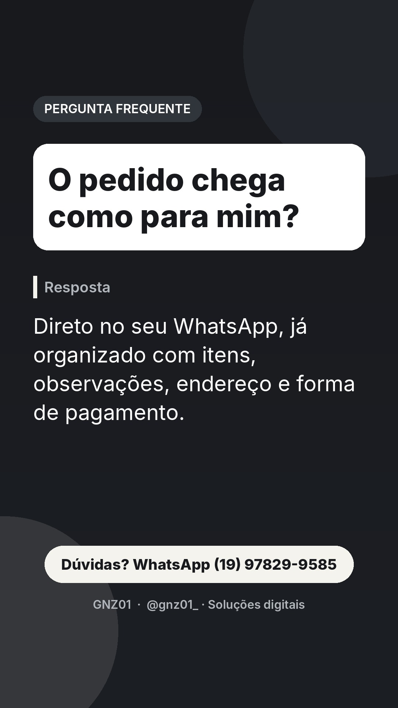
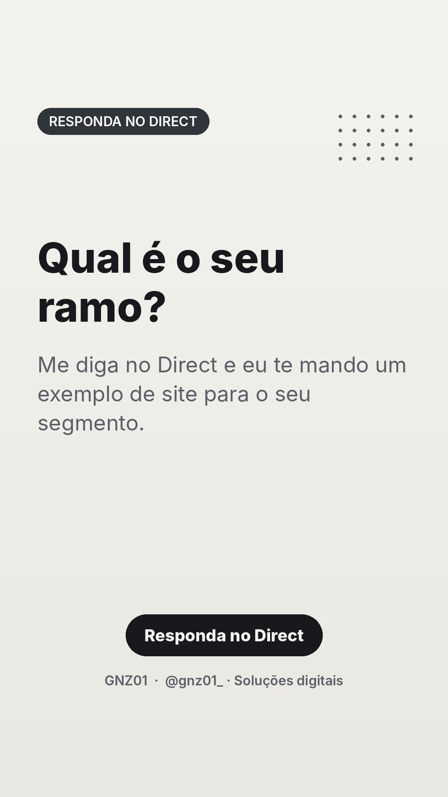
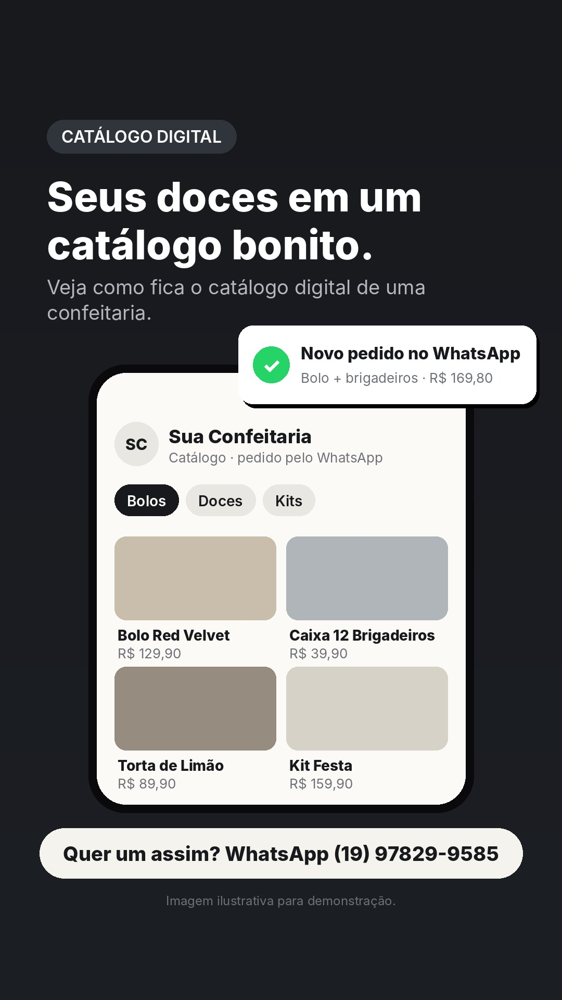
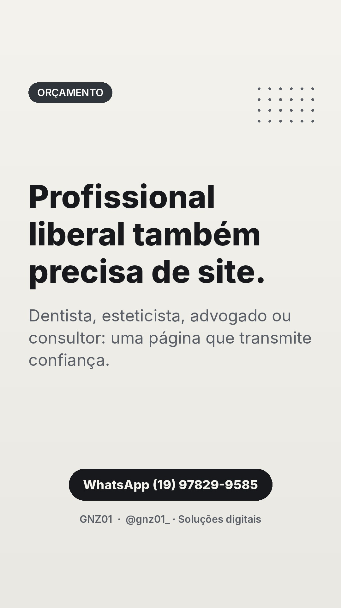

# Stories de 09/11 (segunda)

Funil do dia: conexão de manhã, dúvidas frequentes ao longo do dia, pergunta para o Direct, demonstração à noite e chamada para orçamento antes de dormir.

## 07:30 · Texto

**Segunda: cada tela testada no celular.**
Mais da metade dos acessos chega pelo celular. Por isso testamos ali primeiro.
CTA: WhatsApp (19) 97829-9585

## 09:30 · Pergunta frequente

**O pedido chega como para mim?**
CTA: Dúvidas? WhatsApp

## 11:00 · Demonstração: prévia de site

**Contabilidade que o cliente encontra e entende.**
Veja como fica o site de um escritório de contabilidade.
CTA: Dúvidas? WhatsApp

## 13:30 · Texto

**Qual é o seu ramo?**
Me diga no Direct e eu te mando um exemplo de site para o seu segmento.
CTA: Responda no Direct
Dica ao publicar manualmente: adicione a figurinha de enquete ou caixa de perguntas por cima (a API não permite figurinhas).

## 16:30 · Pergunta frequente

**Funciona para quem tem mais de um profissional?**
CTA: Dúvidas? WhatsApp

## 19:30 · Demonstração: catálogo digital

**Seus doces em um catálogo bonito.**
Veja como fica o catálogo digital de uma confeitaria.
CTA: Quer um assim? WhatsApp

## 22:00 · Texto

**Profissional liberal também precisa de site.**
Dentista, esteticista, advogado ou consultor: uma página que transmite confiança.
CTA: WhatsApp (19) 97829-9585

