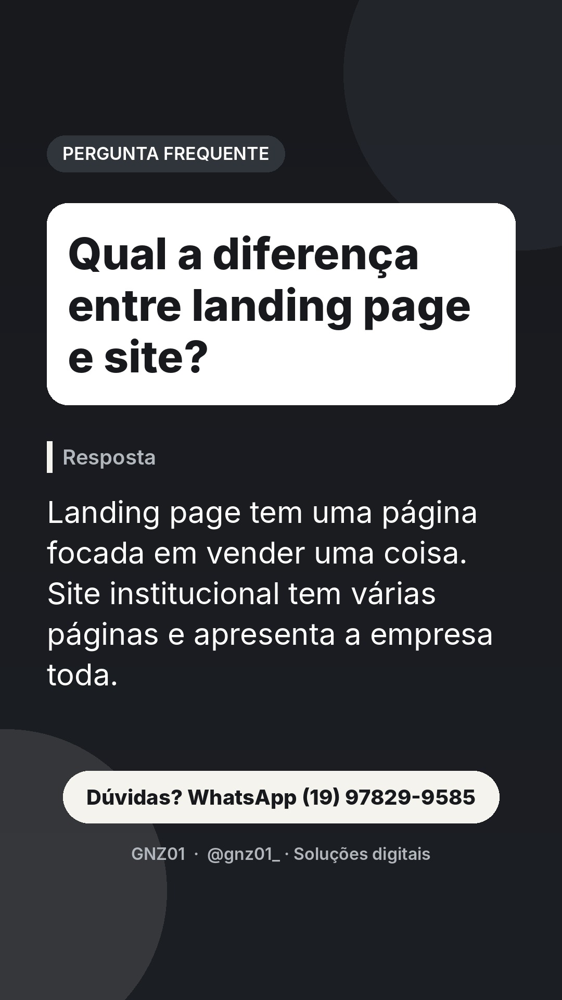
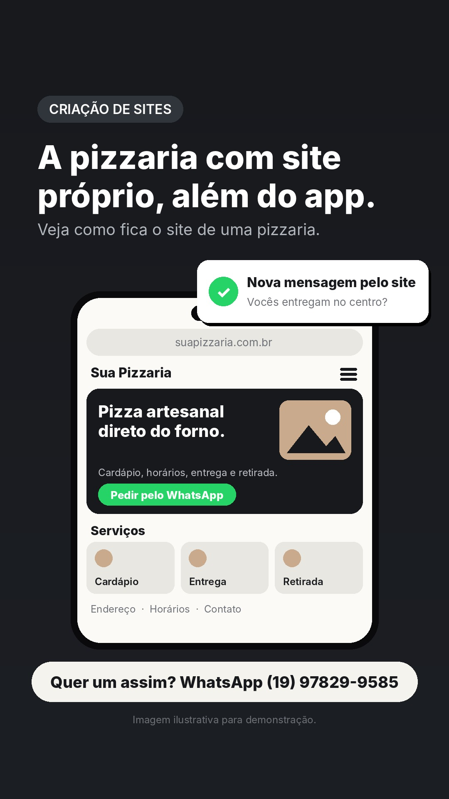
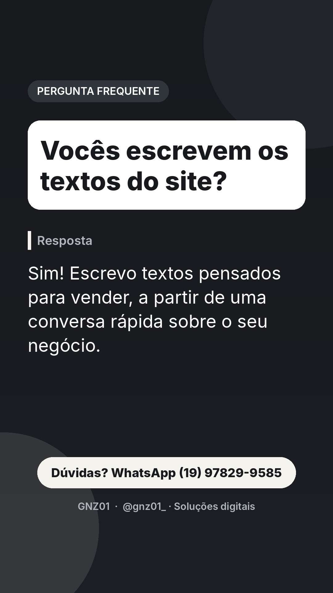
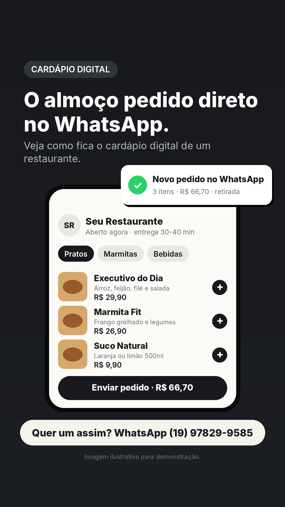

# Stories de 11/11 (quarta)

Funil do dia: conexão de manhã, dúvidas frequentes ao longo do dia, pergunta para o Direct, demonstração à noite e chamada para orçamento antes de dormir.

## 07:30 · Texto

**Hoje é dia de ajuste fino.**
Fonte, espaço, cor e botão. O que parece detalhe é o que passa confiança.
CTA: WhatsApp (19) 97829-9585

## 09:30 · Pergunta frequente

**Qual a diferença entre landing page e site?**
CTA: Dúvidas? WhatsApp

## 11:00 · Demonstração: prévia de site

**A pizzaria com site próprio, além do app.**
Veja como fica o site de uma pizzaria.
CTA: Dúvidas? WhatsApp

## 13:30 · Texto

**Você já perdeu cliente por demora na resposta?**
Uma página que informa sozinha ajuda a não perder mais.
CTA: Responda no Direct
Dica ao publicar manualmente: adicione a figurinha de enquete ou caixa de perguntas por cima (a API não permite figurinhas).

## 16:30 · Pergunta frequente

**Vocês escrevem os textos do site?**
CTA: Dúvidas? WhatsApp

## 19:30 · Demonstração: cardápio digital

**O almoço pedido direto no WhatsApp.**
Veja como fica o cardápio digital de um restaurante.
CTA: Quer um assim? WhatsApp

## 22:00 · Texto

**Agenda aberta 24h para seus clientes.**
Eles marcam sozinhos, você recebe tudo organizado.
CTA: WhatsApp (19) 97829-9585

