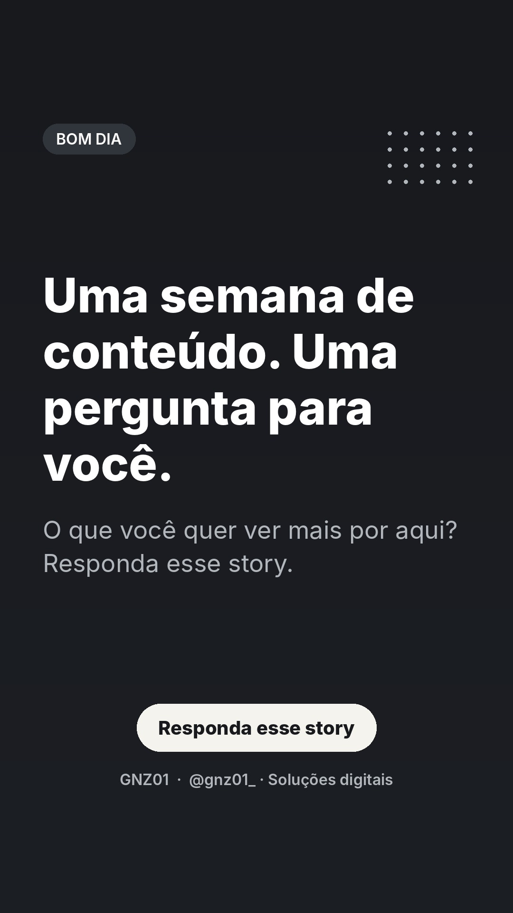
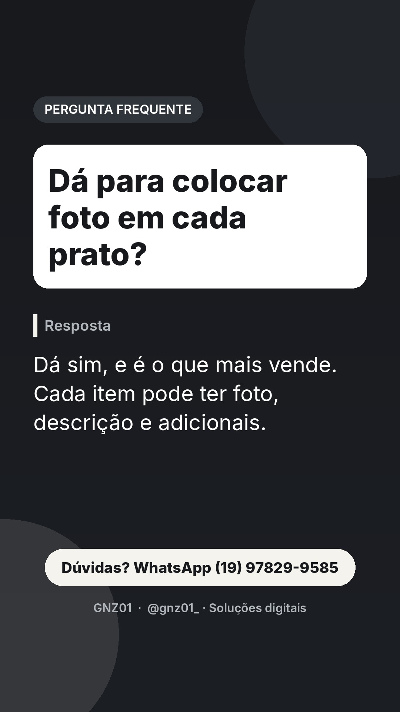
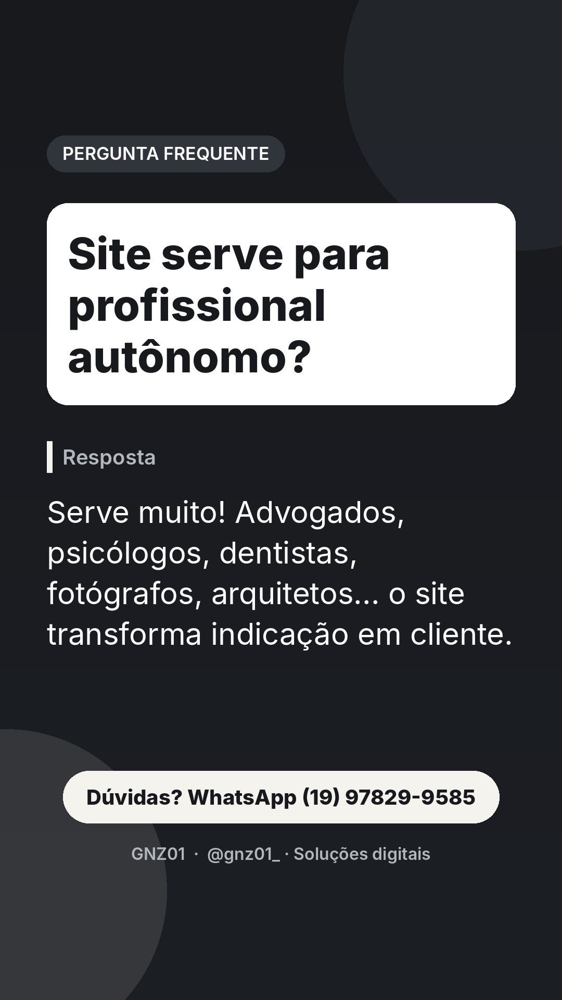
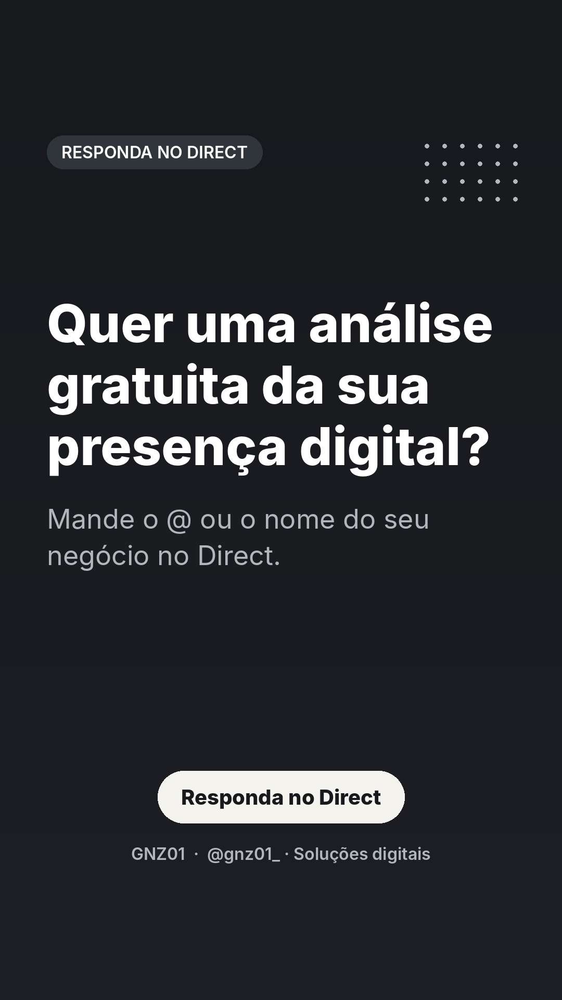
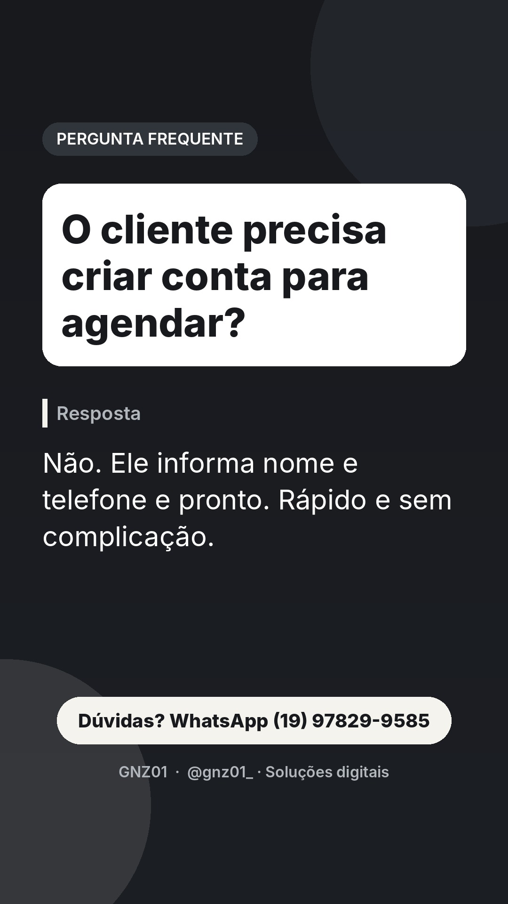
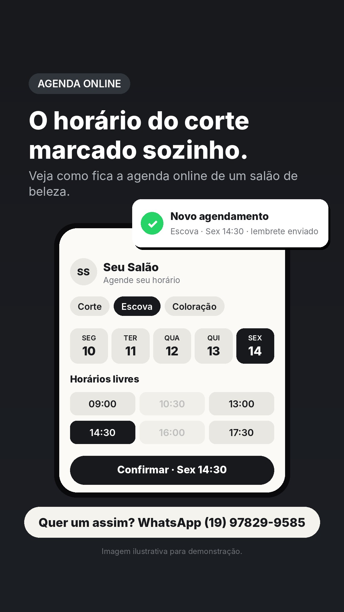

# Stories de 12/11 (quinta)

Funil do dia: conexão de manhã, dúvidas frequentes ao longo do dia, pergunta para o Direct, demonstração à noite e chamada para orçamento antes de dormir.

## 07:30 · Texto

**Uma semana de conteúdo. Uma pergunta para você.**
O que você quer ver mais por aqui? Responda esse story.
CTA: Responda esse story

## 09:30 · Pergunta frequente

**Dá para colocar foto em cada prato?**
CTA: Dúvidas? WhatsApp

## 11:00 · Pergunta frequente

**Site serve para profissional autônomo?**
CTA: Dúvidas? WhatsApp

## 13:30 · Texto

**Quer uma análise gratuita da sua presença digital?**
Mande o @ ou o nome do seu negócio no Direct.
CTA: Responda no Direct
Dica ao publicar manualmente: adicione a figurinha de enquete ou caixa de perguntas por cima (a API não permite figurinhas).

## 16:30 · Pergunta frequente

**O cliente precisa criar conta para agendar?**
CTA: Dúvidas? WhatsApp

## 19:30 · Demonstração: agenda online

**O horário do corte marcado sozinho.**
Veja como fica a agenda online de um salão de beleza.
CTA: Quer um assim? WhatsApp

## 22:00 · Texto

**Feche a semana com um plano para a sua presença digital.**
Chame no WhatsApp e solicite seu orçamento personalizado.
CTA: WhatsApp (19) 97829-9585

